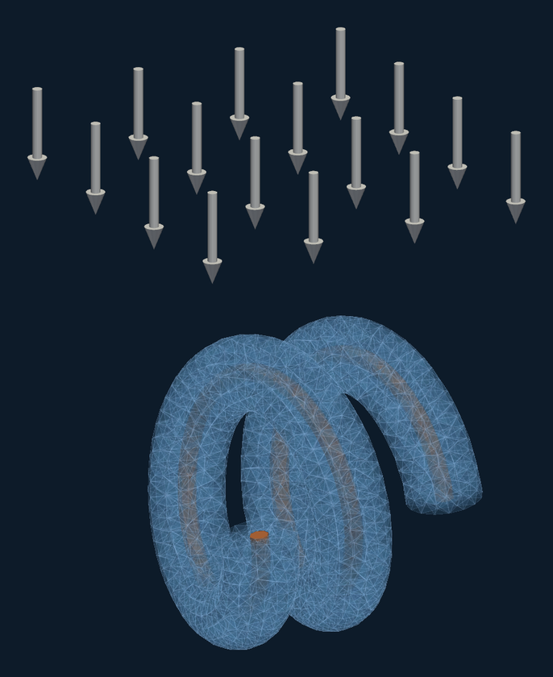
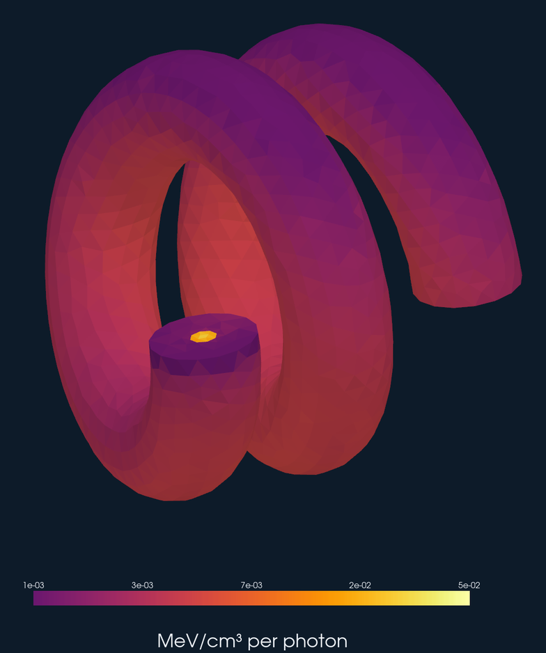
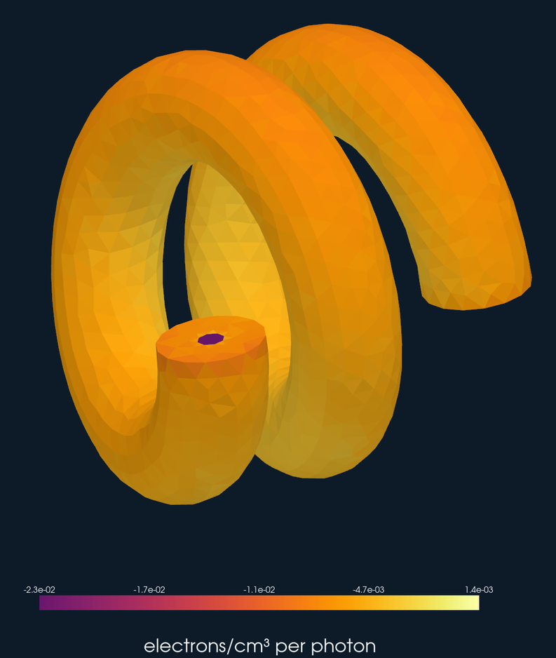
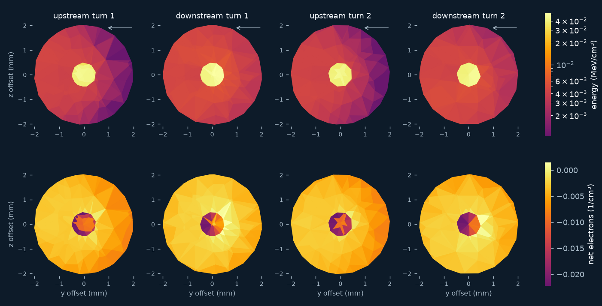
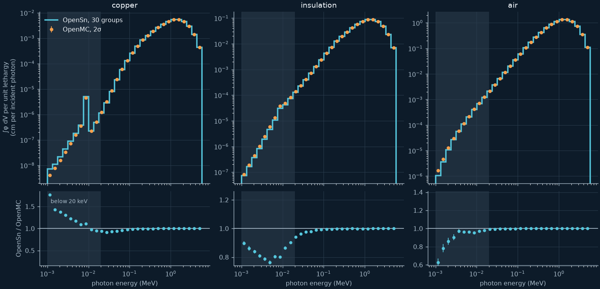

# Coiled wire: coupled photon-electron transport

A broad, parallel beam of photons crosses a two-turn coil of
polyethylene-insulated copper wire in air. The photons set electrons in motion
by Compton scattering, photoelectric absorption, and pair production. Many of
those electrons leave the thin insulation and the copper core before they
stop, so the wire acquires a net charge and absorbs less energy than the
photons deliver to it. OpenSn computes both effects with coupled 30-group
photon and 40-group electron discrete-ordinates transport, treating the
electrons in the restricted continuous-slowing-down approximation (CSDA).

<p align="center"></p>

## Problem

| Item | Value |
| --- | --- |
| Coil | helix of radius 0.60 cm about z, pitch 0.55 cm, 2 turns, starting at (0.6, 0, 0) cm |
| Wire | copper core of radius 0.05 cm, polyethylene jacket of outer radius 0.20 cm |
| Air box | [-1.20, 1.20] x [-1.35, 1.35] x [-0.45, 1.75] cm |
| Beam | uniform over the inlet face y = 1.35 cm, travelling along -y |
| Spectrum | proportional to E exp(-E / 0.7 MeV), 1 keV to 5.7765 MeV |
| Boundaries | vacuum on the other five faces |

| Material | Composition (mass fraction) | Density (g/cm³) |
| --- | --- | --- |
| Copper | Cu | 8.96 |
| Polyethylene | H 0.143716, C 0.856284 | 0.94 |
| Dry air | C 0.000124, N 0.755268, O 0.231781, Ar 0.012827 | 0.001205 |

All results are per incident photon. Energy deposition is in MeV, and
charge deposition is in electrons: a positive value means that more electrons
stop in a region than are set in motion there. The physical charge density is
-e times the charge deposition.

## Model

**Cross sections.** `xs/` holds the three coupled photon-electron libraries
that the example needs, in CEPXS-BFP format, and `xs/groups.json` with their
group bounds. Each library couples 30 logarithmic photon groups and 40
logarithmic electron groups between 1 keV and 5 MeV, with full
photon-electron coupling (bremsstrahlung, fluorescence, and secondary
electrons), at Legendre order 7. OpenSn reads them with
`LoadFromCEPXS(..., csda_format=True)`. The libraries were generated with a
modified version of CEPXS. If you are interested in those modifications,
contact the OpenSn developers.

The scattering order of the solve must equal the Legendre order of the
libraries. `coil.py` stops with an error if the two differ.

**Mesh.** `generate_mesh.py` builds the geometry with the Gmsh API, sweeping
the circular wire cross section along the helix perpendicular to its
centerline. Its `--size-factor` option scales every target tetrahedron size.
Factor 1 gives 0.2 mm in copper, 0.4 mm in the insulation, and 0.4 mm to 3 mm
in the air. The example ships two meshes:

| Mesh | Size factor | Tetrahedra | Use | Copper volume | Insulation volume |
| --- | --- | --- | --- | --- | --- |
| `coil_f4.msh` | 4 | 6,284 | default run and regression test | 0.03850 cm³ (-36%) | 0.8407 cm³ (-6.3%) |
| `coil_f2.msh` | 2 | 35,163 | production results and figures | 0.05509 cm³ (-8.0%) | 0.8837 cm³ (-1.6%) |

The percentages compare the meshed volumes with the true volumes, 0.05985 cm³
of copper and 0.8977 cm³ of insulation. Flat facets cut the curved surfaces,
so a coarse mesh loses volume. The results below are therefore also given per
unit mass, which removes most of that loss. Gmsh does not reproduce a mesh
bit for bit across versions and machines, so the committed meshes, not
regenerated ones, define the stored results.

**Transport.** `coil.py` places the beam on the single Lebedev ordinate
along -y, normalized so that one photon per second enters the inlet face.
Lebedev sets contain the coordinate axes, so the beam needs no approximation
of its direction. The production settings are:

| Setting | Value |
| --- | --- |
| Angular quadrature | Lebedev order 23 (194 directions) |
| Scattering order | P7 |
| Groupsets | one, all 70 groups |
| Inner solver | GMRES(10) with within-group DSA (WGDSA), AAH sweeps |
| Tolerance | 1e-9 |

### Converging the electrons

The GMRES stopping test measures one residual for the whole groupset. The
photon flux fills the air box, whereas the electron flux is concentrated in
the wire, so the electrons are about 0.2% of that residual norm. A tolerance
that converges the photons can therefore leave the electrons short. The
charge deposition, a small difference between electrons set in motion and
electrons that stop, is the most sensitive result. The CSDA particle balance,
which only the electrons affect, shows it.

WGDSA solves this. It accelerates the electron groups, which scatter strongly,
so a moderate tolerance converges them. On the coarse mesh at P7:

| Solver | Tolerance | GMRES(10) iterations | Particle balance |
| --- | --- | --- | --- |
| no WGDSA | 1e-9 | 150 | -3.0e-5 |
| no WGDSA | 1e-11 | 198 | 5.9e-8 |
| WGDSA | 1e-11 | 82 | 2.2e-11 |
| WGDSA | 1e-9 | 58 | 5.9e-9 |

Without WGDSA, a tolerance of 1e-9 leaves the copper charge 4.4% off. With
WGDSA, all deposition and leakage results at 1e-9 agree with the 1e-11
solution to 1e-5. WGDSA costs a few percent more time per iteration and 10%
more memory. At P15 it cuts the iterations from about 560 to 180.

`coil.py` checks the CSDA particle balance and the charge closure in addition
to energy conservation, and stops with an error if any exceeds 1e-6 per
incident photon.

## Results

The production run uses `coil_f2.msh` with the settings above. Its particle
balance is -9.6e-10, and energy is conserved to 8e-11 of the incident energy.

| Region | Mass on the mesh (g) | Energy (MeV) | Energy per mass (MeV/g) | Charge (electrons) | Charge per mass (electrons/g) |
| --- | --- | --- | --- | --- | --- |
| Copper | 0.4936 | 2.298e-3 | 4.656e-3 | -7.701e-4 | -1.560e-3 |
| Insulation | 0.8307 | 3.414e-3 | 4.110e-3 | -3.042e-3 | -3.662e-3 |
| Air | 0.01605 | 9.56e-6 | 5.96e-4 | -1.705e-4 | -1.062e-2 |

| Electrons leaving the box | Per incident photon |
| --- | --- |
| through the outlet face (downstream) | 2.112e-3 |
| through the four side faces | 1.815e-3 |
| back through the inlet face | 5.50e-5 |

Every region loses charge: the photons set more electrons in motion there than
stop there. The net loss, 3.98e-3 electrons per incident photon, equals the
electrons that leave the box, to 1e-9. About 37% of the energy that the
photons give to electrons leaves the box with them, and 53% of those electrons
leave through the outlet face.

<p align="center">
  
  
</p>

The figures show the deposition on the surface of the coil, with the beam
entering from the top as in the first figure. The open end of the wire, which
faces up at the left, shows the copper core. Energy deposition per volume is largest in
the copper, whose density is almost ten times that of the insulation. The
upstream side of each jacket receives less energy than the downstream side,
because the electrons that the beam sets in motion travel forward before they
deposit their energy. The charge deposition is negative almost everywhere,
and most negative in the copper. The cross sections below show the interior
of the wire where it crosses the plane x = 0. The few positive cells there,
where more electrons stop than start, lie in the insulation next to the
copper. They are only a few cells wide, and the copper charge is the least
mesh-converged result (see below).



### Accuracy

The production results are converged to the following levels. All values
are relative changes of the region totals.

**Scattering order.** On `coil_f2.msh`:

| Result | P3 | P5 | P7 |
| --- | --- | --- | --- |
| Copper energy | +1.3% | +0.6% | reference |
| Insulation energy | +0.5% | +0.6% | reference |
| Copper charge | -2.4% | -1.0% | reference |
| Insulation charge | -1.0% | -0.6% | reference |

On `coil_f4.msh`, going from P7 to P15 changes the insulation energy by -1.9%,
the copper energy by -0.75%, and the copper and insulation charge by +0.8% and
+1.6%. The P7 results are therefore within about 2% of the converged
scattering order. Forward-peaked electron scattering converges slowly in
Legendre order.

**Mesh.** At P3, per unit mass:

| Result | f4 to f2 | f2 to `f1.4` (size factor 1.4) |
| --- | --- | --- |
| Copper energy | +5.8% | +0.7% |
| Insulation energy | +2.0% | +0.2% |
| Copper charge | -21% | -4.1% |
| Insulation charge | -2.5% | -0.1% |

The energy deposition per mass is converged to about 1% in copper and 0.2% in
the insulation. The copper charge is the least converged result: the copper
core is only a few cells across, and its charge is the difference of two
nearly equal electron currents through its surface. The totals on the mesh
track the meshed volume. OpenMC's copper heating per meshed volume, for
example, is the same on the f2, f1.4, and f1 meshes to 0.1%.

## Comparison with OpenMC

OpenMC does not transport electrons. With its thick-target bremsstrahlung
treatment, an electron deposits its kinetic energy, less the bremsstrahlung it
emits, where it is created. OpenMC therefore checks the photon field directly
and the energy given to electrons, and it does not compute charge deposition.

`make_dagmc.py` converts the faces between materials in the OpenSn mesh into
a DAGMC geometry, so OpenMC tracks photons through the same faceted coil.
`openmc_reference.py` runs continuous-energy OpenMC 0.16.0 with ENDF/B-VIII.0
photon data, the same beam and spectrum, 10^9 histories (100 batches of
10^7), and seed 20261112. `openmc_results_f2.json` and `openmc_results_f4.json`
hold its results on the two meshes. `compare_openmc.py` prints the comparison.

| Photon result | OpenSn | OpenMC | Difference |
| --- | --- | --- | --- |
| Flux integral in copper (cm) | 1.03089e-2 | 1.03137e-2 ± 0.01% | -0.05% |
| Flux integral in insulation (cm) | 1.66971e-1 | 1.67043e-1 ± 0.01% | -0.04% |
| Flux integral in air (cm) | 2.52252 | 2.52262 ± 0.003% | -0.004% |
| Transmitted through the outlet | 0.98854 | 0.98881 ± 0.003% | -0.03% |
| Scattered out of the four sides | 9.632e-3 | 9.485e-3 ± 0.03% | +1.5% |
| Scattered back out of the inlet | 1.320e-3 | 1.303e-3 ± 0.08% | +1.3% |

The photon flux in every region and the transmitted beam agree to 0.05%. The
photons scattered out of the box, about 1% of the beam, are 1.3% to 1.8% high
per face. That difference does not change with the mesh (f1.4 gives the same
values) and shrinks with the scattering order (+2.0% to +2.7% at P3). The
likely cause is the 30-group photon data of the libraries, which represent the scattered
photon spectrum less finely than continuous-energy ENDF/B-VIII.0. We have not
isolated it further.

| Energy given to electrons | OpenSn | OpenMC |
| --- | --- | --- |
| deposited in the box (MeV) | 5.722e-3 | 8.976e-3 (local deposition) |
| carried out of the box by electrons (MeV) | 3.300e-3 | not transported |
| total (MeV) | 9.022e-3 | 8.976e-3 |
| total / incident energy | 6.416e-3 | 6.469e-3 |

The energy that the photons give to electrons is the same physical quantity
in both codes. OpenSn evaluates energies at the group centers, so its
incident energy is 1.4062 MeV, whereas OpenMC samples the spectrum exactly,
1.3875 MeV. Relative to their own incident energies, the two agree to 0.8%.
OpenMC's local deposition puts 30% more energy in the copper and 72% more in
the insulation than OpenSn, because it keeps the energy of the electrons that
OpenSn transports out of the wire. That difference is the reason to transport
the electrons.



The spectra agree within 0.7% in every group above 135 keV, and both codes
show the copper K fluorescence near 8 keV. Below 20 keV (shaded), the photon
flux differs by up to 77% per group in copper, 24% in the insulation, and 37%
in the air. These photons carry 0.7% of the energy that photons give up in
copper and 0.02% in the insulation, so they do not affect the deposition. The
difference changes much less with the mesh and the scattering order than its
size, so it most likely comes from the photon data and from how each code
makes photons from electrons. The libraries produce bremsstrahlung and
fluorescence along the electron tracks, whereas OpenMC emits them where the electron is
created. We have not isolated the cause.

## Running

Requirements: OpenSn built with Python support (console or module), Gmsh's
Python module to regenerate the mesh, and pyvista and matplotlib for the
figures. The OpenMC comparison also needs OpenMC built with DAGMC and pymoab.

The default run uses `coil_f4.msh` and is the regression test. It takes 4.5
minutes on 32 cores and 36 GB of memory.

```sh
mpiexec -n 32 /path/to/opensn -i coil.py      # or: mpiexec -n 32 python3 coil.py
python3 check_results.py                       # regression checks
```

The production run uses `coil_f2.msh`. It takes 66 GMRES iterations, 26
minutes on 64 cores, and 182 GB of memory. `coil_results_f2.json` holds its
results.

```sh
mpiexec -n 64 /path/to/opensn -i coil.py -p "mesh = 'f2'"   # or: python3 coil.py --mesh f2
python3 compare_openmc.py                      # uses coil_results.json and openmc_results_f2.json
python3 make_figures.py
```

`check_results.py` checks three things. The CSDA particle and energy balances
and the charge and energy closures must be below 5e-8 per incident photon. The
region photon flux and the outlet leakage must agree with
`openmc_results_f4.json` within 0.2% and 0.1%. The deposition and electron
leakage must match the stored values within 1e-5.

To regenerate the mesh and the OpenMC reference:

```sh
python3 generate_mesh.py --size-factor 2 --output coil_f2.msh
python3 make_dagmc.py --mesh coil_f2.msh --output coil.h5m
python3 openmc_reference.py --dagmc coil.h5m --output openmc_results_f2.json
```

## Files

| File | Purpose |
| --- | --- |
| `coil.py` | OpenSn input |
| `check_results.py` | Regression checks of the default run |
| `coil_f4.msh`, `coil_f2.msh` | Default and production meshes |
| `coil_results_f2.json` | Production results |
| `xs/` | Cross-section libraries and group bounds |
| `generate_mesh.py` | Gmsh geometry and mesh |
| `make_dagmc.py` | DAGMC geometry from the mesh |
| `openmc_reference.py`, `openmc_results_f2.json`, `openmc_results_f4.json` | OpenMC photon reference |
| `compare_openmc.py` | OpenSn and OpenMC comparison tables |
| `make_figures.py`, `assets/` | Figures, each on a dark (`-dark.png`) and a white (`-light.png`) background |
