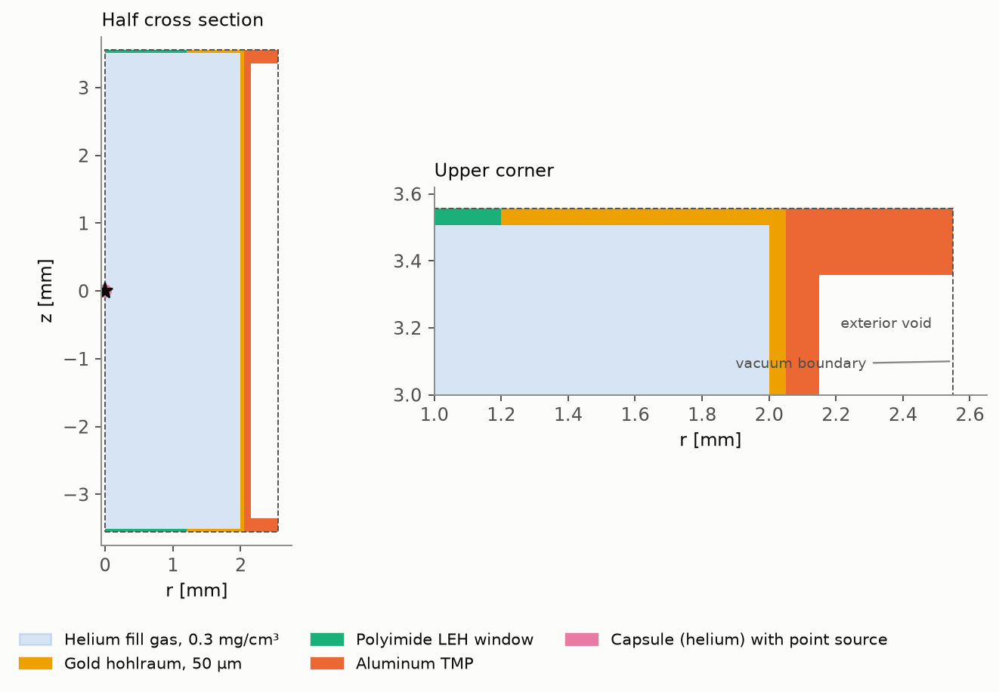
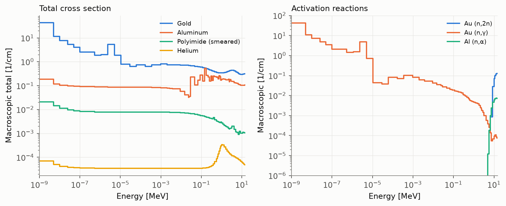
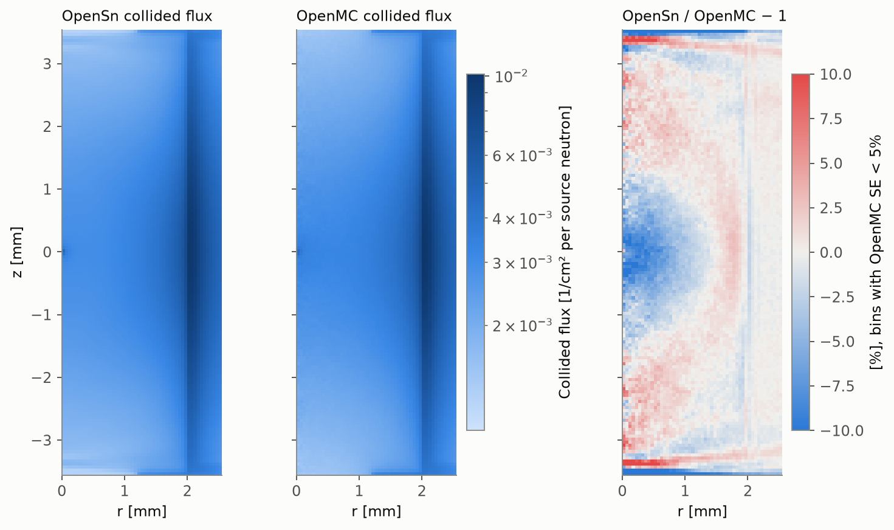
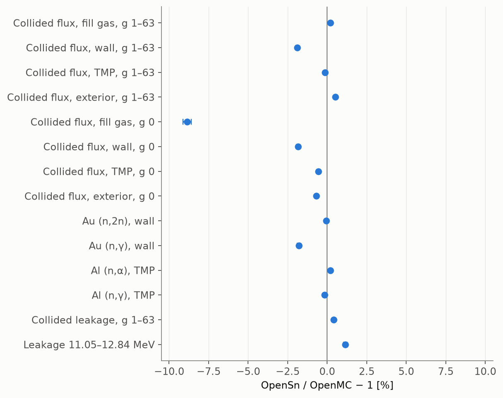
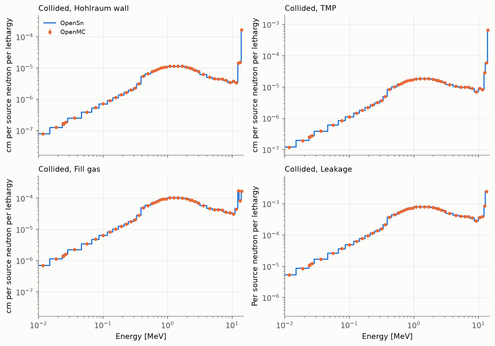

# ICF Fusion Engineering

**Three-dimensional deterministic neutron transport from a DT point source through an
indirect-drive ICF target, compared with continuous-energy Monte Carlo**

## Summary

This example analyzes the 14.1 MeV DT neutrons of an inertial confinement fusion (ICF)
implosion as they cross the target around it: the helium fill gas, the gold hohlraum and
the polyimide windows of its laser entrance holes (LEH), and the aluminum
thermal-mechanical package (TMP). The neutrons are emitted from a point at the center of
the capsule. The target is optically thin, so almost all of the neutrons escape without
colliding, and a discrete-ordinates calculation of a point source would be dominated by
ray effects. OpenSn therefore computes the uncollided flux by ray tracing from the source
and solves only for the collided flux with the discrete-ordinates method. The calculation
uses 64 energy groups, transport-corrected P3 scattering, and 1,024 directions on 989,832
tetrahedra. The cross sections were generated for this problem with OpenMC from
ENDF/B-VIII.0 data, and the results are compared with a continuous-energy OpenMC
calculation of the same geometry, materials, and source.

The main findings are:

- The uncollided flux agrees with semi-analytic integrals to 0.08% in every region except
  the capsule, whose faceted surface makes it 0.24% low. These differences are the volume
  errors of the faceted mesh regions: over the regions of the mesh itself, the uncollided
  flux of OpenSn is exact to 0.005%. The uncollided flux of OpenMC, which tracks the
  analytic surfaces, agrees with the semi-analytic integrals to 1e-5.
- The collided flux agrees with OpenMC to 1.9% in the gold wall and 0.7% or better in the
  TMP and outside the target, in the source group and below it. The gold (n,2n) and
  aluminum (n,α) rates agree to 0.06% and 0.2%, the offsets that the multigroup weighting
  of the source group predicts. The gold (n,γ) rate is 1.8% low, because the group capture
  cross sections are self-shielded for an infinite gold medium, not for a 50 µm wall.
- The leakage, 1.000572 neutrons per source neutron, agrees with OpenMC to 1e-6. The
  collided leakage below the source group agrees to 0.4%, and its spectrum to 1.2% RMS.
- Elastic scattering of 14 MeV neutrons on gold is so strongly forward peaked that no
  affordable Legendre order represents it. The transport correction reduces the error of
  the source-group collided flux in the fill gas from 36%, with plain P3 on a coarser
  mesh, to 9%.
- The collided flux in the 50 µm gold wall and the 100 µm TMP converges slowly with the
  number of polar angles, because it comes mostly from neutrons that travel nearly
  parallel to these layers. The collided flux in the LEH windows is 16% low with every
  quadrature that was tried.
- The uncollided flux took 33 minutes on one MPI rank with 96 threads. The collided flux
  took 47 source iterations and 48 minutes on 768 MPI ranks, with 2.4 TB of memory.

## Contents

- [Problem description](#problem-description)
- [Nuclear data](#nuclear-data)
- [Transport model](#transport-model)
- [Results](#results)
- [Comparison with continuous-energy Monte Carlo](#comparison-with-continuous-energy-monte-carlo)
- [Discussion](#discussion)
- [Conclusions](#conclusions)
- [Appendix: reproducing the results](#appendix-reproducing-the-results)

## Problem description

### Geometry

The target is axisymmetric about the z axis. It is modeled in full three dimensions,
because the point source lies on every symmetry plane and the uncollided-flux method does
not accept a source on a reflecting boundary. The outer boundary is the cylinder
`r = 2.55 mm`, `|z| ≤ 3.557 mm`, and it is a vacuum boundary. The void between the two
TMP flanges is part of the model, so that the outer boundary is convex and neutrons that
leave the TMP there can still enter a flange.

<picture>
  <source media="(prefers-color-scheme: dark)" srcset="assets/geometry-dark.png">
  
</picture>

*Figure 1. Half cross section of the target in the r-z plane. The star marks the point
source at the center of the capsule. The dashed line is the vacuum boundary.*

*Table 1. Regions, dimensions, and materials. Lengths are in mm.*

| Block | Region | Dimensions | Material, density [g/cm³] |
| --- | --- | --- | --- |
| 1 | Capsule | Sphere, `R = 0.1` | Helium, 3.0e-4 (the fill gas) |
| 2 | Fill gas | `r < 2.0`, `|z| < 3.507`, outside the capsule | Natural helium, 3.0e-4 |
| 3 | Hohlraum wall | Side wall `2.0 < r < 2.05`, end walls `3.507 < |z| < 3.557` outside the LEH | Gold, 19.32 |
| 4 | LEH windows | `r < 1.2`, `3.507 < |z| < 3.557` | Polyimide, 0.0142 (a 0.5 µm window spread over the 50 µm hole) |
| 5 | TMP | Sleeve `2.05 < r < 2.15`, `|z| < 3.557`, and flanges `2.15 < r < 2.55`, `3.357 < |z| < 3.557` | Aluminum, 2.699 |
| 6 | Exterior | `2.15 < r < 2.55`, `|z| < 3.357` | Void |

The hohlraum is 4.0 mm in diameter and 7.014 mm long inside, with 50 µm gold walls and a
2.4 mm diameter LEH in each end.

### Materials

The materials represent a gold hohlraum of the kind fielded at the National Ignition
Facility (NIF):

- **Hohlraum wall.** Gold at full density. NIF also fields depleted-uranium hohlraums with a
  gold lining, which would add fast fission to this problem.
- **LEH windows.** Each LEH is covered by a polyimide (C₂₂H₁₀N₂O₅, 1.42 g/cm³) window
  0.5 µm thick. The window is spread over the 50 µm thickness of the hole, which keeps its
  areal density. Its thin aluminum flash coating is neglected.
- **Fill gas.** Natural helium at 0.3 mg/cm³, a low gas fill of recent NIF designs.
- **TMP.** Aluminum at full density. The TMP is the machined aluminum can that holds the
  hohlraum and carries the cooling arms on its flanges.
- **Capsule.** In this example the capsule contains the fill gas, so the neutrons see no
  compressed fuel. The capsule is kept in the mesh so that a capsule material can be added
  later.

All materials are at 293.6 K. A cryogenic target is near 20 K, but at the MeV energies
that matter here the temperature has no effect.
[openmc_reference.py](openmc_reference.py) gives the complete compositions.

### Source

The source is a point at the center of the capsule that emits 1 neutron/s isotropically at
14.1 MeV. The thermal broadening of the DT neutron spectrum, a few hundred keV at the ion
temperatures of an implosion, is neglected: the 64-group structure ends at 14.191 MeV, and
the broadening would move part of the source above it. All results are per source
neutron.

## Nuclear data

### Energy groups

For simplicity, this example uses the 64-group structure of the
[Tokamak Fusion Engineering](../Tokamak_Fusion_Engineering/README.md#energy-groups)
example, which is also a 14.1 MeV fusion source problem. The groups span 0 to 14.191 MeV,
and group 0, from 13.84 to 14.191 MeV, contains the source. The boundaries are a subset of
the VITAMIN-J 175-group boundaries with four thermal boundaries added below 0.1 eV. The
tokamak example describes how they were chosen.

OpenMC tallies every cross section directly in the 64 groups as a reaction rate divided by
the scalar flux of the group, both from a continuous-energy calculation. Each group cross
section is therefore the continuous-energy data averaged over the group with the weighting
spectrum described below.

### Group cross sections

The 64-group libraries were generated with OpenMC from ENDF/B-VIII.0 continuous-energy data
by [generate_xs.py](generate_xs.py).

The target is optically thin. Only about 0.3% of the source neutrons collide, and almost
none of them slow down below 100 keV, so a library weighted by the spectrum of the target
itself would leave most of the lower groups empty. Each material is therefore weighted in
its own infinite medium, a reflecting cube filled with that material, with 10⁸ analog
source neutrons. 99% of the source is at 14.1 MeV and 1% is spread over the whole group
structure with a 1/E spectrum, so that every group is sampled, even in gold, which
captures most neutrons in its resonances before they reach thermal energies.

`materials_64g_p5.h5` holds the total and physical absorption cross sections, the P0 to P5
neutron-production scattering matrices, which include (n,2n) and other multiplying
reactions, and the (n,2n), (n,γ), and (n,α) cross sections used for the reaction rates.
OpenMC's consistent scattering estimator makes the P0 scattering cross section equal to the
total minus the absorption cross section.

<picture>
  <source media="(prefers-color-scheme: dark)" srcset="assets/cross-sections-dark.png">
  
</picture>

*Figure 2. Macroscopic total cross sections of the four materials without the transport
correction, and the gold (n,2n) and (n,γ) and aluminum (n,α) cross sections. Over the
50 µm gold wall, the 14.1 MeV total cross section of 0.313/cm gives an optical thickness
of 0.0016.*

*Table 2. Statistical quality of the group cross sections.*

| Material | Median statistical error of the group total cross sections | Largest |
| --- | ---: | ---: |
| Gold | 0.088% | 1.4% |
| Aluminum | 0.026% | 0.39% |
| Polyimide | 0.038% | 0.11% |
| Helium | 0.026% | 0.096% |

The nine gold groups with errors above 1% all lie below 61 eV, where gold captures most
neutrons in its resonances. They carry a negligible part of the reaction rates of the
target.

### Transport correction

Elastic scattering of 14 MeV neutrons on gold is so strongly forward peaked that the
within-group Legendre moments of gold in group 0 are 1, 0.89, 0.76, 0.66, 0.57, and 0.50
times the P0 moment for P0 to P5. A truncated expansion of such a kernel oscillates and has
large negative lobes. For a point source, the first-collision source in each direction is
this truncated kernel itself, so its oscillations go directly into the collided flux.

`materials_64g_p3tc.h5`, the library that [hohlraum.py](hohlraum.py) uses, removes the
forward peak with the extended transport correction. In each group `g`, the within-group
P4 moment `σ₄,g→g` is subtracted from the total cross section and from the within-group P0
to P3 moments, and the expansion is truncated at P3. The neutrons in the forward peak are
treated as not having collided. In group 0 the correction is 28% of the total cross
section of gold and 17% of that of aluminum. Absorption, the transfers between groups,
and the reaction cross sections are unchanged. The 35 within-group P4 moments that are
negative, at most 1.1% of the total cross section, are set to zero, so the correction
never increases a cross section.

The uncollided flux of OpenSn uses the corrected total cross section too, so it includes
the neutrons of the forward peak. Its uncollided and collided flux are therefore not the
uncollided and collided flux of OpenMC, and the comparison in this report uses quantities
that have the same meaning in both codes.

[provenance/materials_64g_p5.json](provenance/materials_64g_p5.json) records the OpenMC
version and commit, the SHA-256 of every nuclear data file, of the generating scripts, of
the OpenMC inputs and statepoints, and of both libraries, and the statistical quality of
every material. With the same OpenMC build and nuclear data, both libraries are reproduced
bit for bit.

The group-0 cross sections are averages over the flux of the infinite medium, which
includes neutrons that scattered elastically below 14.1 MeV without leaving the group. In
the target, the group-0 flux is almost entirely the uncollided 14.1 MeV line. The group-0
gold (n,2n) and aluminum (n,α) cross sections therefore differ from their 14.1 MeV values
by -0.07% and +0.19%, and the reaction rates in Table 8 have offsets of the same size.

## Transport model

### Uncollided and collided flux

A point source in an optically thin target is a worst case for the discrete-ordinates
method: the flux streams from the source along the discrete directions only, and the ray
effects dominate the solution. OpenSn splits the flux into an uncollided and a collided
part. The uncollided flux, `exp(-τ)/(4π s²)` at distance `s` from the source, is
computed by ray tracing. Its first collisions are the source of a discrete-ordinates
calculation of the collided flux, which is spread over the walls and smooth, and the
uncollided flux is added back to the result.

The two parts are computed in two runs of [hohlraum.py](hohlraum.py). The first runs on
one MPI rank and writes the uncollided flux moments to `hohlraum_uncollided.h5`. The
second reads them on any number of ranks and solves for the collided flux. Inside the
near-source region, the 0.2 mm cube around the capsule, the uncollided flux is ray traced
to the quadrature points of every cell. The cell that contains the source is represented
by its exact cell-average flux, and the cells around it are integrated exactly over
direction. Outside the near-source region, the uncollided flux is computed by a sweep
along the directions from the source. The source sits at the centroid of a regular
tetrahedron that [generate_mesh.py](generate_mesh.py) embeds in the capsule mesh, so it is
far from every face, edge, and vertex.

*Table 3. OpenSn discretization and solver.*

| Setting | Value |
| --- | --- |
| Mesh | 989,832 linear tetrahedra |
| Spatial discretization | Piecewise-linear discontinuous (PWLD) |
| Energy | 64 groups, 0 to 14.191 MeV |
| Scattering | Transport-corrected P3, 16 flux moments |
| Uncollided flux | Ray tracing in the 0.2 mm cube around the capsule, sweep along the source directions elsewhere |
| Angular quadrature, collided flux | Gauss-Legendre-Chebyshev, 16 polar × 64 azimuthal = 1,024 directions |
| Sweep | AAH |
| Iteration | Source iteration on one groupset |
| Convergence | `1e-7` pointwise relative change of the scalar flux |

The elements are about 70 µm in the 50 µm gold wall, the LEH windows, and the 100 µm TMP.
In the fill gas they grow from 14 µm at the capsule to 140 µm near the hohlraum wall.

Only 0.3% of the source neutrons collide, so the scattering source converges in a few
iterations. Most of the iterations converge the angular fluxes that the AAH sweep lags on
the cycles of the tetrahedral mesh and on the partition boundaries. On 768 ranks, 3.6% of
the angular unknowns are lagged. GMRES needs fewer iterations than source iteration, but
each Krylov vector holds the flux moments and the lagged angular fluxes, about 106 GB on
768 ranks, so 20 of them would about double the memory.

### Sensitivity to the discretization

The settings of Table 3 were chosen with calculations on meshes with 99,633 (coarse) and
381,502 (medium) tetrahedra, made with `--size-factor 2` and `1` of
[generate_mesh.py](generate_mesh.py).

The uncollided flux converges with the mesh to the semi-analytic integrals of
[uncollided_reference.py](uncollided_reference.py) (Table 4). The capsule, a sphere 0.1 mm
in radius, has the largest error, because the faceted sphere is smaller than the true one.

*Table 4. Error of the region-integrated uncollided flux, without the transport
correction.*

| Region | Coarse | Medium | Production |
| --- | ---: | ---: | ---: |
| Capsule | -1.92% | -0.49% | -0.24% |
| Fill gas | +0.018% | +0.005% | +0.002% |
| Hohlraum wall | +0.099% | +0.018% | +0.010% |
| LEH windows | -0.48% | -0.033% | -0.032% |
| TMP | +0.077% | +0.019% | +0.012% |
| Exterior | -0.58% | -0.15% | -0.075% |

Table 5 compares the collided flux with OpenMC for other angular quadratures and
scattering treatments. Group 0 is compared separately, because it is where the transport
correction acts. The group-0 collided flux of OpenSn is its total group-0 flux minus the
uncollided flux without the transport correction on the same mesh.

*Table 5. Difference of the region-integrated collided flux from OpenMC.*

| Mesh | Coarse | Coarse | Coarse | Coarse | Coarse | Medium | Production |
| --- | ---: | ---: | ---: | ---: | ---: | ---: | ---: |
| Scattering | P3 | P3 | P3 | P5 | **TC-P3** | P3 | **TC-P3** |
| Directions | 144 | 256 | 576 | 144 | **144** | 144 | **1,024** |
| Hohlraum wall, groups 1 to 63 | -5.8% | -4.5% | -3.2% | -5.8% | -5.8% | -5.5% | -1.9% |
| Hohlraum wall, group 0 | -4.1% | -3.8% | -2.2% | -11.6% | -4.6% | -5.3% | -1.9% |
| TMP, groups 1 to 63 | -2.9% | -1.8% | -0.7% | -3.0% | -2.9% | -2.9% | -0.1% |
| TMP, group 0 | +1.8% | +0.4% | +0.0% | +3.6% | -0.6% | +1.4% | -0.6% |
| Fill gas, groups 1 to 63 | +0.4% | +0.5% | +0.4% | +0.5% | +0.4% | +0.3% | +0.2% |
| Fill gas, group 0 | -35.8% | -43.5% | -41.1% | -24.8% | -7.7% | -33.5% | -8.9% |
| Exterior, group 0 | +3.5% | +3.0% | +3.0% | -1.3% | -0.5% | +3.8% | -0.7% |
| LEH windows, groups 1 to 63 | -16.5% | -18.9% | -17.9% | -17.7% | -16.5% | -16.2% | -15.6% |
| Leakage, groups 1 to 63 | +0.5% | +0.5% | +0.5% | +0.5% | +0.5% | +0.4% | +0.4% |

The table separates two errors:

- **The collided flux in the thin layers, groups 1 to 63.** Neutrons that scatter in the
  gold wall or the TMP and stay in the layer travel nearly parallel to it. The error of
  the wall and TMP flux decreases from -5.8% to -3.2% and from -2.9% to -0.7% as the
  number of polar angles grows from 6 to 12, and is insensitive to the mesh and the
  scattering order. With the 16 polar angles of the production calculation it is -1.9%
  and -0.1%.
- **The source group.** Only the scattering treatment changes it. P5 is no better than P3
  in the wall and the TMP. The transport correction reduces the error in the fill gas
  from -36% to -8% and in the exterior to -0.5%, without changing groups 1 to 63.

The production calculation therefore uses the transport correction and 16 polar angles.
The collided flux in the LEH windows, groups 1 to 63, is 16% to 19% low with every
setting. See [Discussion](#discussion).

## Results

The collided flux converged in 47 source iterations, and the particle balance of the
calculation closes to 3e-14 of the source. 1.000572 neutrons leak per source neutron: the
(n,2n) reactions in the gold wall, 7.2e-4 per source neutron, add more neutrons than the
target absorbs, 1.5e-4 per source neutron, 99% of them in the aluminum TMP and 57% by
aluminum (n,α) reactions. 0.30% of the source neutrons collide before they leave the
target.

*Table 6. Region-integrated scalar flux [cm] and reaction rates per source neutron.*

| Region | Flux | Collided flux, groups 1 to 63 | Absorption | (n,2n) | (n,γ) | (n,α) |
| --- | ---: | ---: | ---: | ---: | ---: | ---: |
| Capsule | 9.9765e-3 | 1.6315e-8 | 1.7761e-13 | 0 | 3.1259e-17 | 0 |
| Fill gas | 2.5016e-1 | 2.7541e-4 | 4.4688e-12 | 0 | 7.8461e-16 | 0 |
| Hohlraum wall | 5.7178e-3 | 3.0224e-5 | 1.2910e-6 | 7.1614e-4 | 5.7239e-7 | 9.0688e-8 |
| LEH windows | 2.7364e-4 | 6.1944e-7 | 1.8244e-8 | 1.1240e-10 | 1.8832e-11 | 1.4602e-8 |
| TMP | 1.1490e-2 | 5.5558e-5 | 1.4681e-4 | 4.3317e-6 | 4.3593e-7 | 8.3710e-5 |
| Exterior | 3.8456e-2 | 1.3560e-4 | 0 | 0 | 0 | 0 |

<picture>
  <source media="(prefers-color-scheme: dark)" srcset="assets/collided-flux-dark.png">
  
</picture>

*Figure 3. Azimuthally averaged collided scalar flux in the r-z plane, from OpenSn and
OpenMC, and their relative difference, on 0.05 mm bins. The OpenSn collided flux is the
total flux minus the uncollided flux without the transport correction, subtracted at each
node of the mesh, so it has the meaning of the OpenMC collided flux in every group.*

The collided flux is largest in the gold wall, where most of the collisions happen, and it
fills the fill gas almost uniformly. OpenSn and OpenMC agree to within a few percent in
most of the target: the median difference over the bins with an OpenMC standard error
below 5% is 0.9%. Within 1 mm of the source, OpenSn is 6% low, because its collided flux
in the source group is negative there. See [Discussion](#discussion). Near the LEH, OpenSn
is 5% to 9% high in the fill gas 0.1 to 0.2 mm below the windows and 10% to 18% low next
to and in them.

## Comparison with continuous-energy Monte Carlo

The reference is an OpenMC calculation with continuous-energy ENDF/B-VIII.0 cross sections
on the analytic geometry, with the same materials, source, and boundary conditions, and
10¹⁰ analog source neutrons in 100 batches. OpenMC tallies every quantity for all neutrons
and for source neutrons that have not collided. A neutron born in the capsule with no
collision is uncollided. Neutrons from (n,2n) reactions also start with no collision, but
they are born outside the capsule. The collided part is the difference of the two tallies
in each batch, so its standard error includes their correlation. The reference does not
share any approximation with OpenSn except the nuclear data evaluation. The uncertainties
are one standard error (SE) of the mean.

*Table 7. Uncollided flux, relative to the semi-analytic integrals over the analytic
regions and over the faceted regions of the mesh.*

| Region | Faceted regions, relative to analytic | OpenSn, relative to faceted | OpenSn, relative to analytic | OpenMC, relative to analytic |
| --- | ---: | ---: | ---: | ---: |
| Capsule | -0.2352% | -0.0000% | -0.2352% | +0.0000% ± 0.0000% |
| Fill gas | +0.0030% | -0.0008% | +0.0022% | +0.0001% ± 0.0002% |
| Hohlraum wall | +0.0094% | +0.0007% | +0.0101% | +0.0002% ± 0.0003% |
| LEH windows | -0.0267% | -0.0049% | -0.0317% | -0.0010% ± 0.0038% |
| TMP | +0.0094% | +0.0026% | +0.0120% | +0.0009% ± 0.0006% |
| Exterior | -0.0758% | +0.0003% | -0.0755% | -0.0001% ± 0.0005% |
| Leakage | - | - | -0.0000% | +0.0000% ± 0.0001% |

OpenMC tracks the analytic surfaces of the target, so its uncollided flux differs from the
semi-analytic integrals only by its statistical error. The regions of the mesh are bounded
by flat faces, and their volumes differ slightly from those of the analytic regions: the
faceted capsule is inscribed in the sphere, and the faceted outer boundary in the outer
cylinder. The first column of Table 7 is the exact uncollided flux, with the same optical
depths and cross sections as the semi-analytic integrals, integrated over the tetrahedra
of each mesh block instead of over the analytic region. It accounts for almost all of the
OpenSn difference. Over the regions of the mesh itself, the uncollided flux of OpenSn is
exact to 0.005%, and the remaining differences from OpenMC are those of the faceted
geometry. They decrease as the mesh is refined at the curved surfaces (Table 4).

The faceted integrals use the transport-corrected cross sections. The capsule integral is
evaluated as a direction integral to its faceted boundary, and the other blocks with an
11-point tetrahedron rule. Replacing the continuous-energy total cross sections at
14.1 MeV with the group-0 cross sections changes the semi-analytic integrals by less than
1e-6, so the uncollided flux of OpenSn without the transport correction (Table 4) differs
from that of OpenMC by the same amounts.

*Table 8. Collided flux [cm], reaction rates, and leakage per source neutron.*

| Quantity | OpenSn | OpenMC | Difference |
| --- | ---: | ---: | ---: |
| Collided flux, fill gas, groups 1 to 63 | 2.7541e-4 | 2.7487e-4 ± 0.05% | +0.20% |
| Collided flux, hohlraum wall, groups 1 to 63 | 3.0224e-5 | 3.0809e-5 ± 0.05% | -1.90% |
| Collided flux, LEH windows, groups 1 to 63 | 6.1944e-7 | 7.3412e-7 ± 0.30% | -15.62% |
| Collided flux, TMP, groups 1 to 63 | 5.5558e-5 | 5.5636e-5 ± 0.04% | -0.14% |
| Collided flux, exterior, groups 1 to 63 | 1.3560e-4 | 1.3491e-4 ± 0.03% | +0.51% |
| Collided flux, fill gas, group 0 | 3.7632e-6 | 4.1287e-6 ± 0.26% | -8.85% |
| Collided flux, hohlraum wall, group 0 | 4.0665e-6 | 4.1432e-6 ± 0.07% | -1.85% |
| Collided flux, TMP, group 0 | 1.6508e-5 | 1.6603e-5 ± 0.04% | -0.57% |
| Collided flux, exterior, group 0 | 5.3273e-5 | 5.3638e-5 ± 0.03% | -0.68% |
| Gold (n,2n), hohlraum wall | 7.1614e-4 | 7.1660e-4 ± 0.0003% | -0.06% |
| Gold (n,γ), hohlraum wall | 5.7239e-7 | 5.8278e-7 ± 0.10% | -1.78% |
| Aluminum (n,α), TMP | 8.3710e-5 | 8.3543e-5 ± 0.0006% | +0.20% |
| Aluminum (n,γ), TMP | 4.3593e-7 | 4.3663e-7 ± 0.002% | -0.16% |
| Absorption, hohlraum wall | 1.2910e-6 | 1.3062e-6 ± 0.05% | -1.16% |
| Absorption, TMP | 1.4681e-4 | 1.4669e-4 ± 0.0006% | +0.08% |
| Leakage | 1.000572 | 1.000573 ± 3e-7 | -9e-7 |
| Collided leakage, groups 1 to 63 | 2.3422e-3 | 2.3329e-3 ± 0.03% | +0.40% |
| Leakage, 11.052 to 12.84 MeV | 8.3124e-5 | 8.2186e-5 ± 0.10% | +1.14% |

<picture>
  <source media="(prefers-color-scheme: dark)" srcset="assets/openmc-comparison-dark.png">
  
</picture>

*Figure 4. Relative difference of the OpenSn responses from OpenMC. Error bars show one
OpenMC standard error. They do not include the OpenSn discretization errors.*

Every difference in Table 8 except those of the leakage is larger than the OpenMC
uncertainty, so all of them are errors of the multigroup discrete-ordinates calculation.
The quantities that come mostly from uncollided 14.1 MeV neutrons agree best. The gold
(n,2n) and aluminum (n,α) rates differ by the offsets of the group-0 cross sections,
-0.07% and +0.19%, and the total leakage agrees to 1e-6. The collided flux in the TMP and
the exterior agrees to 0.7% in group 0 and in groups 1 to 63, and in the gold wall to
1.9%. The largest differences are in the source-group collided flux of the fill gas and
in the LEH windows, which hold 0.7% and 0.13% of the collided flux of the target.

<picture>
  <source media="(prefers-color-scheme: dark)" srcset="assets/openmc-spectra-dark.png">
  
</picture>

*Figure 5. Collided flux per unit lethargy in the hohlraum wall, the TMP, and the fill gas,
and the collided leakage spectrum. OpenMC markers show ±1 standard error.*

*Table 9. Agreement of the collided spectra in groups 1 to 63, over the groups whose
OpenMC standard error is below 5%.*

| Spectrum | Groups compared | RMS group difference | Largest group difference |
| --- | ---: | ---: | ---: |
| Fill gas | 49 | 2.1% | +7.6% (group 3, 11.1 to 12.2 MeV) |
| Hohlraum wall | 49 | 2.4% | +5.4% (group 49, 354 to 961 eV) |
| LEH windows | 38 | 16.7% | -24.8% (group 38, 46 to 67 keV) |
| TMP | 49 | 1.0% | +3.8% (group 49, 354 to 961 eV) |
| Exterior | 49 | 1.1% | -3.5% (group 47, 2.0 to 2.7 keV) |
| Leakage | 49 | 1.2% | -5.5% (group 47, 2.0 to 2.7 keV) |

## Discussion

### Sources of the remaining differences

The remaining differences of Table 8 have five sources:

- **Angular quadrature.** The collided flux in the gold wall and the TMP converges slowly
  with the number of polar angles (Table 5). With 16 polar angles, the wall is 1.9% low
  in groups 1 to 63 and in group 0, and the TMP 0.1% and 0.6% low.
- **Scattering representation of the source group.** The source-group collided flux in
  the fill gas comes from neutrons that scatter through large angles and stay in group 0:
  in the gold wall, where elastic scattering loses at most 2% of the neutron energy, and,
  near the source, in the helium. The transport-corrected P3 kernels are least accurate
  at large angles, where the truncated expansion of a forward-peaked kernel oscillates.
  Within 1 mm of the source, where the scattering in the helium dominates and the
  neutrons reach the region around the source only by scattering backward, the
  source-group collided flux of OpenSn is negative. Over the whole fill gas it is 8.9%
  low, against 36% low with plain P3 on the coarse mesh.
- **Resonance self-shielding.** The gold (n,γ) rate is 1.8% low, and the wall absorption
  1.2% low, because their collided part, 26% of the (n,γ) rate, is 8.1% low. Between 1 eV
  and 1 keV the collided flux in the wall agrees with OpenMC to 2%, but its (n,γ) rate is
  82% low, and between 1 and 100 keV the rate is 24% low with the flux 2.5% low. The
  group cross sections were weighted in an infinite gold medium, where the flux is
  depressed in the capture resonances, so they are much smaller than those of a 50 µm
  wall, in which the resonances are only weakly self-shielded. The collided aluminum
  (n,γ) rate in the TMP is 10% low, mostly because the rate between 1 and 100 keV, where
  aluminum has its resonances, is 61% low. A library weighted with the spectrum of the
  target, or with self-shielding for the thickness of each layer, would reduce this
  error.
- **Multigroup weighting of the source group.** The group-0 cross sections differ from
  their 14.1 MeV values by -0.07% for gold (n,2n) and +0.19% for aluminum (n,α), and the
  rates in Table 8 differ by -0.06% and +0.20%.
- **The LEH windows.** The collided flux in the LEH windows is 16% to 19% low with every
  mesh, quadrature, and scattering treatment of Table 5. The collided neutrons there come
  mostly from the gold around the hole and travel nearly parallel to the 50 µm window.
  Those from the gold end wall reach it only along directions within about 0.06 in cosine
  of its plane, while the polar directions closest to that plane are 0.24, 0.125, and
  0.095 in cosine with 6, 12, and 16 polar angles. Figure 3 shows the pattern that
  directions too steep for this transport would give: the fill gas next to the windows
  is 10% low and the fill gas 0.1 to 0.2 mm below them is 5% to 9% high, as if the
  neutrons were carried too far from the plane of the end wall. A quadrature with polar
  directions closer to that plane would test this explanation. The windows hold 0.13% of
  the collided flux of the target, so this does not affect the other results.

### Computational cost

*Table 10. Measured cost of the OpenSn calculation.*

| Stage | Hardware | Iterations | Wall time | Peak memory |
| --- | --- | ---: | ---: | ---: |
| Uncollided flux | 1 MPI rank, 96 threads | - | 33 min | 53 GB |
| Collided flux | 768 MPI ranks | 47 | 48 min | 2.4 TB, 3.1 GB per rank |

The first stage spends 14 minutes in the solver, 13 of them in the sweep outside the
near-source region, and 14 minutes after the solver, in the serial region integrals of
the reaction rates and in the output of the uncollided flux. The sweep processes all 64
groups, although only group 0 has an uncollided source.

The second stage spends 9 minutes reading the uncollided flux and 36 minutes in the 47
source iterations, 42 seconds per sweep of 2.6e11 angular unknowns. The uncollided file
holds all 16 flux moments of all 64 groups, about 33 GB, although only group 0 is
nonzero. Every rank of the second stage reads each moment of it in full.

## Conclusions

OpenSn's uncollided-flux method makes a discrete-ordinates calculation of a point source
in an optically thin target practical. Ray tracing and the sweep reproduce the uncollided
flux over the regions of the mesh to 0.005%, so nearly all of the error of the uncollided
flux comes from the faceted geometry, and it is 0.08% or less except in the capsule. With
transport-corrected P3 scattering and 1,024 directions, the collided flux agrees with
continuous-energy Monte Carlo to 1.9% in the gold wall and 0.7% in the TMP and outside the
target. The responses that matter most for the engineering of the target, the gold (n,2n)
and aluminum (n,α) activation and the leakage, agree to 0.2% or better, which is the
accuracy of the multigroup weighting of the source group.

The larger differences have identified causes: the resonance self-shielding of the
infinite-medium capture cross sections, the forward-peaked elastic kernels of gold and
helium in the source group, and the slow convergence of the collided flux in the thin
layers with the number of polar angles. The 16% deficit in the LEH windows, which hold a
small part of the collided flux, is most likely an effect of the angular quadrature too.

## Appendix: reproducing the results

### Files

| File | Purpose |
| --- | --- |
| [hohlraum.py](hohlraum.py) | OpenSn input, for both stages of the calculation |
| `hohlraum.msh.gz` | Compressed Gmsh mesh |
| `materials_64g_p3tc.h5` | 64-group transport-corrected P3 cross sections in OpenMC format, used by OpenSn |
| `materials_64g_p5.h5` | 64-group P5 cross sections without the transport correction |
| [openmc_reference.py](openmc_reference.py) | Continuous-energy OpenMC model of the same problem |
| `openmc_reference_results.json` | Results of the OpenMC reference calculation |
| [uncollided_reference.py](uncollided_reference.py) | Semi-analytic uncollided flux |
| [compare_openmc.py](compare_openmc.py) | Comparison of the OpenSn results with OpenMC and the semi-analytic uncollided flux |
| [generate_xs.py](generate_xs.py) | Script that generates the cross sections with OpenMC |
| [generate_mesh.py](generate_mesh.py) | Script that generates the mesh with Gmsh |
| [provenance/materials_64g_p5.json](provenance/materials_64g_p5.json) | Record of every input and output of the cross-section generation |
| `assets/` | Figures of this report |

### Running OpenSn

These results were computed with OpenSn 1.0.1, built from `main` with the fix for
uncollided rays that graze cell edges, which the first stage needs on this mesh. The
calculation needs large-scale resources, so it is not part of the automated example
tests.

Run the first stage on one MPI rank, with threads, and the second stage on many ranks:

```sh
gunzip -k hohlraum.msh.gz
OPENSN_NUM_THREADS=96 srun -n 1 -c 96 opensn -i hohlraum.py
export OPENSN_NUM_THREADS=1
srun -n 768 opensn -i hohlraum.py
```

The first stage writes `hohlraum_uncollided.h5`, `hohlraum_uncollided.json`, and
`hohlraum_uncollided.pvtu`, and stops. The second stage prints the particle balance and the
region table, writes `hohlraum_results.json`, and writes the scalar flux of every group to
`hohlraum_flux.pvtu` and one `.vtu` piece per rank. The arrays `phi_gGGG_m00` hold the
scalar flux of group `GGG`, numbered from the highest energy. When it starts, every rank
reads each 2 GB moment of `hohlraum_uncollided.h5` in full. On 768 ranks the peak memory
was 3.1 GB per rank. To start over, delete `hohlraum_uncollided.h5`.

### Comparing with the references

```sh
python3 uncollided_reference.py
python3 compare_openmc.py hohlraum_results.json openmc_reference_results.json \
    uncollided_reference.json
```

[uncollided_reference.py](uncollided_reference.py) evaluates the semi-analytic uncollided
flux for the transport-corrected and uncorrected multigroup cross sections and for the
continuous-energy cross sections. It needs SciPy, and continuous-energy ENDF/B-VIII.0 data
through `OPENMC_CROSS_SECTIONS`. [compare_openmc.py](compare_openmc.py) prints the tables
of the comparison. The group-0 rows of Table 8 need the uncollided flux without the
transport correction on the same mesh: run the first stage again in another directory
with `materials_64g_p3tc.h5` replaced by `materials_64g_p5.h5` in `hohlraum.py`, and pass
its `hohlraum_uncollided.json` with `--uncorrected-uncollided`. Only its scalar flux is
used, so `scattering_order = 0` may be set there too: the run then needs 10 GB, and took
13 minutes on 8 threads.

### Running the OpenMC reference

[openmc_reference.py](openmc_reference.py) builds the OpenMC model, runs it, and writes
`openmc_seed<seed>/results.json`. It needs continuous-energy ENDF/B-VIII.0 data for the
nuclides listed in [provenance/materials_64g_p5.json](provenance/materials_64g_p5.json).
These data are not included.

```sh
export OPENMC_CROSS_SECTIONS=/path/to/cross_sections.xml
python3 openmc_reference.py --processes 48
```

The reference took 76 minutes on 48 CPU cores at 2.2 million neutrons per second. It
writes a statepoint after every batch, about 360 kB each.

### Regenerating the cross sections

```sh
export OPENMC_CROSS_SECTIONS=/path/to/endfb-viii.0-hdf5/cross_sections.xml
python3 generate_xs.py --processes 64
```

This takes about 30 minutes on 64 cores and reproduces both libraries bit for bit with the
OpenMC build and nuclear data recorded in the provenance file. OpenSn needs only
`materials_64g_p3tc.h5`.

### Regenerating the mesh

```sh
python3 generate_mesh.py --output hohlraum.msh
```

The script needs the `gmsh` and `numpy` Python packages and takes under a minute. The
supplied mesh was made with Gmsh 4.15.2, and rerunning the script reproduced it bit for
bit. It checks the volume of every block against its analytic value before meshing,
and after meshing it checks that no tetrahedron is inverted and that the source lies at
the centroid of its cell. `--size-factor` scales every element size. Factors 2 and 1 give
the coarse and medium meshes of Tables 4 and 5.

## License

The example and its geometry are distributed under the repository's MIT license.
