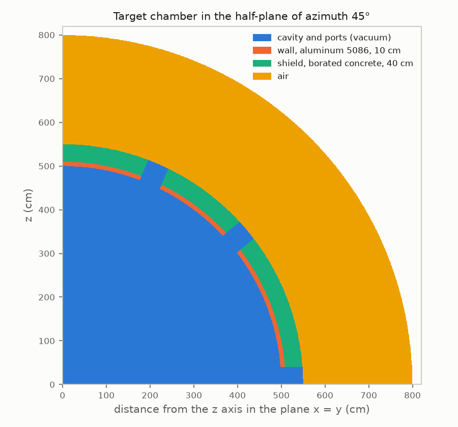
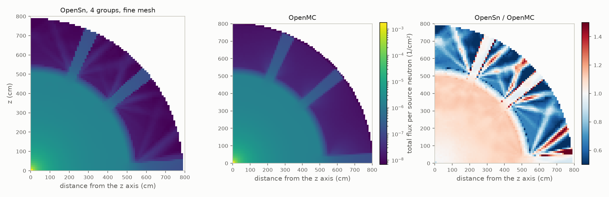
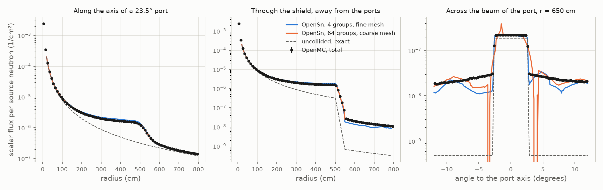
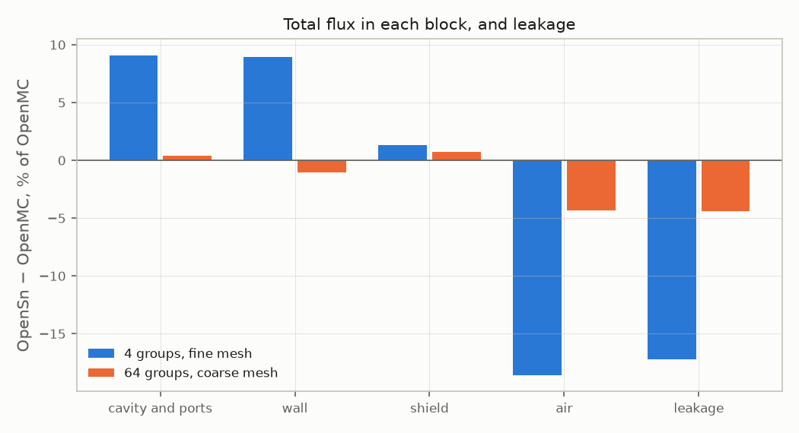
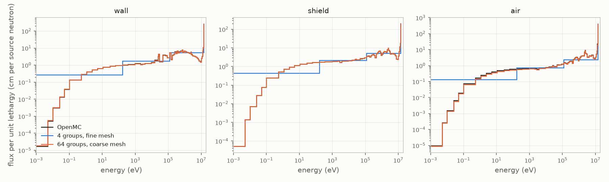
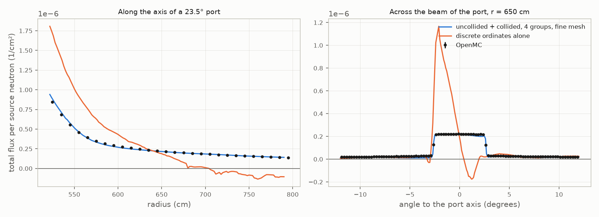

# ICF Target Chamber

**Uncollided and collided neutron flux of a 14.1 MeV point source in a NIF-like target
chamber with 52 open ports, compared with continuous-energy Monte Carlo**

## Summary

This example follows the 14.1 MeV DT neutrons of an inertial confinement fusion (ICF) shot
from the target at the centre of a target chamber, through the aluminum wall and the borated
concrete shield of the chamber, and into the air around it. The chamber is a sphere of 10 m
diameter, like the target chamber of the National Ignition Facility (NIF), crossed by 52
cylindrical ports through which the neutrons stream out without colliding. Beyond the shield,
the uncollided flux in the beams of the ports is several hundred times that behind the
concrete, the total flux about ten times, and the edges of these beams are a few centimetres
wide.

A discrete-ordinates calculation of a point source in this geometry would be dominated by ray
effects. OpenSn therefore computes the uncollided flux of the source by ray tracing through the
material interfaces of the mesh, and solves for the collided flux alone by discrete
ordinates, with the first collisions of the uncollided flux as its source. The chamber is
symmetric about the three coordinate planes, so the model is one octant with the source at
its corner and reflecting boundaries on the three planes. The multigroup cross sections were
generated for this problem with OpenMC from ENDF/B-VIII.0 data, and the results are compared
with a continuous-energy OpenMC calculation of the whole chamber.

The main findings are:

- The uncollided flux of OpenSn agrees with semi-analytic integrals to 0.01% in the cavity, the
  wall and the shield and to 0.14% in the air, on the fine mesh that refines the edges of the
  port beams. The uncollided flux of OpenMC agrees with them to its standard error.
- With the 64-group P3 library on a coarse mesh (125,189 tetrahedra), the total flux and the
  absorption, (n,2n), (n,γ) and (n,α) rates agree with OpenMC to 1.3% in the cavity, the wall and
  the shield. In the air the flux and the leakage are 4.4% low, most likely from the coarse
  mesh (the same mesh costs the 4-group library 4.8 points there).
- With the 4-group transport-corrected P0 library on the fine mesh (1,299,969 tetrahedra), the
  results no longer change with the mesh or the quadrature, but differ from OpenMC by +9% in the
  cavity and the wall, +1% in the shield and -19% in the air: four groups and P0 scattering are
  the limit of that configuration. Without the transport correction the differences are two to
  four times larger.
- Along the axis of a port and through the shield, the 64-group flux agrees with OpenMC to 2 to
  4% RMS; across the beam of a port, the coarse mesh smears the edges of the beam, which the
  fine mesh resolves.
- Discrete ordinates alone, with the same mesh and quadrature but without the uncollided flux,
  misses the beams of the ports: along a port axis the flux beyond the shield drops to a few
  percent of its value and turns negative, and across the beam it is wrong by a factor of 2 to 3
  with negative values.
- On one 32-core node, the 4-group fine-mesh calculation takes 19 minutes and 112 GB, the
  64-group coarse-mesh calculation 23 minutes and 122 GB. The uncollided flux, ray traced from
  every cell through the material interfaces of the mesh, is 0.5 to 3% of the cost.

## Contents

- [Problem description](#problem-description)
- [Nuclear data](#nuclear-data)
- [Transport model](#transport-model)
- [Results](#results)
- [Comparison with continuous-energy Monte Carlo](#comparison-with-continuous-energy-monte-carlo)
- [Discussion](#discussion)
- [Conclusions](#conclusions)
- [Appendix: reproducing the results](#appendix-reproducing-the-results)

## Problem description

### Geometry

The chamber is a vacuum sphere of radius 500 cm with a 10 cm aluminum wall and a 40 cm borated
concrete shield, in air up to a radius of 800 cm, where the boundary is vacuum. These are the
diameter, the wall and the shield of the NIF target chamber: a 10 m diameter aluminum sphere
[[1]](#references) with a 10 cm aluminum wall surrounded by 40 cm of borated concrete
[[2]](#references).

The NIF chamber has 48 laser-beam ports on four cones at polar angles of 23.5°, 30°, 44.5°
and 50° from each pole [[3]](#references), 24 direct-drive ports and 120 diagnostic ports
[[2]](#references). This model keeps the 48 beam ports, on the same cones (4, 4, 8 and 8
ports per cone and hemisphere), with a radius of 25 cm, and adds 4 ports of radius 40 cm on the
equator; the other ports are not modeled. The port radii, the azimuths of the ports and the
equatorial ports are choices of this example, which is why it is called NIF-like. Every port
is a cylinder whose axis passes through the centre, open through the wall and the shield. The
arrangement is symmetric about the three coordinate planes.

<picture>
  <source media="(prefers-color-scheme: dark)" srcset="assets/geometry-dark.png">
  
</picture>

*Figure 1. The chamber in the half-plane of azimuth 45°, which contains the axes of a 23.5°
port, a 50° port and an equatorial port.*

*Table 1. Blocks of the mesh, regions and materials.*

| Block | Region | Material, density [g/cm³] |
| --- | --- | --- |
| 1 | `r < 500 cm`, and the ports through the wall and the shield | vacuum |
| 2 | wall, `500 < r < 510 cm` outside the ports | aluminum alloy 5086, 2.66 |
| 3 | shield, `510 < r < 550 cm` outside the ports | borated Portland concrete, 2.3 |
| 4 | air, `550 < r < 800 cm` | dry air, 0.001205 |

### Materials

Compositions are from the PNNL compendium of material compositions [[4]](#references), by
weight:

- **Wall.** Aluminum alloy 5086-O (compendium material 12): 94.65% Al, 4.0% Mg, and Mn, Fe, Si,
  Cr, Zn, Ti, Cu.
- **Shield.** Portland concrete (compendium material 108, 2.3 g/cm³) with 1% of natural boron
  added; the boron content of the NIF shield is not given in the sources used here, so 1% is
  a choice of this example. Hydrogen uses the S(α,β) data of hydrogen in water.
- **Air.** Dry air near sea level (compendium material 4).

All materials are at 293.6 K. [openmc_reference.py](openmc_reference.py) gives the complete
compositions.

### Source

The source is a point at the centre of the chamber that emits 1 neutron/s isotropically at
14.1 MeV. All results are per neutron of this source, for the whole chamber.

## Nuclear data

### Energy groups

Two group structures are used:

- the 64 groups of the [Tokamak](../Tokamak_Fusion_Engineering/README.md) and
  [ICF hohlraum](../ICF_Fusion_Engineering/README.md) examples, from 0 to 14.191 MeV, whose
  group 0, from 13.84 to 14.191 MeV, holds the source;
- 4 groups whose boundaries are boundaries of the 64 groups, so that the 64-group results of
  OpenMC add up exactly to the 4 groups:

| Group | Energies | Share of the flux (wall / shield / air) |
| --- | --- | --- |
| 0 | 13.84 to 14.191 MeV, the source group of the 64 groups | 15% / 10% / 30% |
| 1 | 116.79 keV to 13.84 MeV, fast neutrons | 51% / 49% / 48% |
| 2 | 167.02 eV to 116.79 keV, slowing down | 25% / 27% / 15% |
| 3 | below 167.02 eV | 9% / 14% / 7% |

Group 0 is kept as it is in the 64 groups, so its total cross section is the one at 14.1 MeV
and the uncollided flux has the same meaning in both libraries. Little of the flux is thermal:
the boron absorbs the neutrons as they slow down, and less than 1% of the flux in each
material is below 0.53 eV. Group 3 starts at 167 eV so that it holds the upscattering: in the
64 groups, upscattering above 167 eV (into the group from 167 to 354 eV, in the concrete) is
1e-8 of the scattering of a group, and in the 4 groups what goes up from group 3 to group 2 is
3e-9 of the scattering of group 3.

### Group cross sections

[generate_xs.py](generate_xs.py) tallies the cross sections of each material in the chamber
itself, with the point source, the geometry and the materials of the OpenMC reference: each
material is weighted by its own spectrum in the problem. The run has 2e8 histories. The
largest relative standard error of a 4-group total cross section is 1.3e-3 (air); in 64 groups
the median is 3e-4 to 3e-3, and 3 groups of the aluminum and 7 groups of the air, thermal groups
with almost no flux, are above 1%. The group-0 total cross sections agree with the
continuous-energy values at 14.1 MeV to 1e-4 (aluminum) and 6e-4 (concrete).

Each library holds the total and absorption cross sections, the neutron-production scattering
matrices (OpenMC's consistent estimator, so the P0 scattering cross section is the total minus
the absorption cross section) and the (n,2n), (n,γ) and (n,α) cross sections, used for the
reaction rates. A `void` entry with zero cross sections is used for the cavity and the ports.

| Library | Groups | Scattering |
| --- | --- | --- |
| `materials_64g_p3.h5` | 64 | P3, no transport correction |
| `materials_4g_p0tc.h5` | 4 | P0, extended transport correction |
| `materials_4g_p0.h5` | 4 | P0, no transport correction |

### Transport correction

Elastic scattering at 14 MeV is strongly forward peaked. With P0 scattering every collision is
isotropic, which sends far too many neutrons back into the chamber and too few through the
shield. The transport-corrected 4-group library treats the forward part of the scattering as
no collision: in each group the within-group P1 moment, when positive, is subtracted from the
total cross section and from the within-group P0 moment (the extended transport correction of
the [ICF hohlraum](../ICF_Fusion_Engineering/README.md) example, at order 0). It lowers the
total cross section of group 0 by 26 to 29%, so its uncollided flux is attenuated less: what
it calls uncollided includes the neutrons scattered forward. On the fine mesh, the plain P0
library overestimates the total flux by 30% in the cavity and 34% in the wall and underestimates
it by 38% in the air and the leakage by 36%; the corrected library reduces these differences to
+9%, +9%, -19% and -17%. The corrected library is the 4-group library of this example;
`materials_4g_p0.h5` is kept for comparison.

## Transport model

### Uncollided and collided flux

[chamber.py](chamber.py) runs both stages:

1. The uncollided flux of the source is ray traced from every cell to the source through the
   material hull of the mesh, the triangles between blocks, which every rank holds
   (`method="ray_trace"`, `ray_tracer="material_hull"`). The flux of each cell is corrected so
   that its absorption and its leakage balance the neutrons that enter it. The cells around the
   source are integrated exactly over direction (`exact_near_source_leakage=True`).
2. The collided flux is solved by discrete ordinates with the first collisions of the
   uncollided flux as its source, on the same mesh and with the same boundary conditions; the
   result is the total flux.

The source is at the corner of the octant, on the three reflecting planes. It is given the
strength of the whole source, 1 neutron/s, and OpenSn emits one eighth of it into the octant:
the production rate of both stages is 1/8, and a result divided by it is per neutron of the
whole source, the value of the whole chamber. This needs the OpenSn branch that accepts a point
source on reflecting planes (see the appendix).

### Discretization and solvers

| Setting | Value |
| --- | --- |
| Spatial discretization | piecewise-linear discontinuous (PWLD) on tetrahedra |
| Angular quadrature | Gauss-Legendre-Chebyshev product, 6 polar x 24 azimuthal angles, 144 directions |
| 4 groups | one groupset, GMRES (restart 30), tolerance 1e-8 |
| 64 groups | groupsets of groups 0-49 and 50-63 (the groups that receive upscattering), GMRES (restart 5), tolerance 1e-8, two passes over the groupsets |
| Uncollided flux | P0 moments with 4 groups, P3 moments with 64 groups; all 52 ports ray traced through the material hull |
| Ranks | 32 MPI ranks, one thread each |

Source iteration is not used: with scattering ratios up to 0.99 and no diffusion synthetic
acceleration, which the void cavity rules out, it converges by about 7% per iteration on this
problem, and its pointwise convergence check is dominated by near-zero flux values that change
sign from one iteration to the next. GMRES converges in 30 to 50 iterations with 4 groups. With
64 groups it takes 80 iterations in groups 0-49 and 50 in groups 50-63; the second pass over the
groupsets takes one iteration in each and confirms the solution (change 2e-13).

### Meshes

[generate_mesh.py](generate_mesh.py) meshes the octant with Gmsh. The cell size is `--size` in
the wall, the shield and the ports, grows towards the centre (but stays below 0.15 r, so the
1/r² flux changes by a similar fraction across every cell) and in the air. `--port-size` refines
the mesh along the edges of the beams of the ports: a ray from the source at an angle g to the
axis of a port of radius ρ leaves the port at the radius ρ / sin g, so beyond the shield the
edge of the beam is the cone at the distance ρ t / 525 cm from the axis, a few centimetres
wide. The faces of the mesh are flat, so the spheres and cylinders are faceted; the nodes on the
three coordinate planes are put exactly on them.

| Mesh | Options | Tetrahedra | Use |
| --- | --- | --- | --- |
| fine | `--size 10 --port-size 3` | 1,299,969 | 4 groups |
| coarse | `--size 15` | 125,189 | 4 groups and 64 groups |
| sensitivity | `--size 10 --port-size 5` | 619,294 | 4 groups, mesh and quadrature sensitivity |
| sensitivity | `--size 20` | 61,368 | 64 groups, mesh sensitivity; the pilots |

With 64 groups and P3 moments the collided problem needs about 1 MB per tetrahedron, so on the
250 GB machine of this example it runs on the coarse mesh. [large_machine/](large_machine/README.md)
holds what is needed to run it on the fine mesh on a cluster.

## Results

Three main configurations were run on one 32-core node with 250 GB of memory (the other
runs, sensitivities and comparisons, are listed under [Computational cost](#computational-cost)):

| Configuration | Library | Mesh | Directions | Stage 1 | Stage 2 | Peak memory |
| --- | --- | --- | --- | --- | --- | --- |
| 4 groups, fine mesh | 4 groups, P0 corrected | 1,299,969 tetrahedra | 144 | 20 s | 845 s | 112 GB |
| 4 groups, coarse mesh | 4 groups, P0 corrected | 125,189 tetrahedra | 144 | 2 s | 60 s | 17 GB |
| 64 groups, coarse mesh | 64 groups, P3 | 125,189 tetrahedra | 144 | 6 s | 1,314 s | 122 GB |

The 4-group runs on the two meshes separate the error of the mesh from the error of the library,
and the 64-group run, on the same coarse mesh as the second, separates the error of the library
from the error of the transport solution. The balances close: the uncollided stage to 3e-15
of the production rate, the collided stage to 1e-8.

<picture>
  <source media="(prefers-color-scheme: dark)" srcset="assets/maps-dark.png">
  
</picture>

*Figure 2. Total flux per source neutron in the half-plane of azimuth 45°, which contains the
axes of three ports: OpenSn (4 groups, fine mesh), OpenMC, and their ratio.*

<picture>
  <source media="(prefers-color-scheme: dark)" srcset="assets/profiles-dark.png">
  
</picture>

*Figure 3. Total flux along the axis of a 23.5° port, along a radius through the shield away from
every port, and across the beam of the 23.5° port on the sphere of radius 650 cm; OpenMC (the
average of the 8 equivalent directions), OpenSn, and the exact uncollided flux.*

## Comparison with continuous-energy Monte Carlo

The OpenMC reference ([openmc_reference.py](openmc_reference.py)) has 10^9 histories in 100
batches. Its relative standard errors are 1e-4 or less for the integrals over the blocks and the
leakage, and 5e-4 or less for the reaction rates.

### Uncollided flux

Uncollided flux in each block, OpenSn against the semi-analytic integral computed with the
group-0 total cross section of its library, and OpenMC against the integral computed with the
continuous-energy cross sections at 14.1 MeV (standard error of OpenMC in parentheses):

| Block | 4 groups P0 corrected, fine mesh | 4 groups P0 corrected, coarse mesh | 64 groups P3, coarse mesh | 4 groups P0 (no correction), fine mesh | 64 groups P3, 61,368 tetrahedra | OpenMC against the semi-analytic value (continuous energy) |
| --- | --- | --- | --- | --- | --- | --- |
| cavity and ports | -0.005% | -0.022% | -0.022% | -0.005% | -0.042% | +0.000% (± 5.3e-07) |
| wall | +0.008% | +0.093% | +0.093% | +0.008% | +0.190% | +0.002% (± 1.8e-05) |
| shield | +0.003% | +0.164% | +0.191% | +0.002% | +0.373% | +0.007% (± 6.8e-05) |
| air | -0.137% | -2.722% | -3.522% | -0.171% | -7.358% | +0.012% (± 1.6e-04) |

The uncollided flux of OpenSn in the cavity, the wall and the shield is exact to 0.01% on the
fine mesh. The remaining 0.14% in the air, the 2.7 to 3.5% of the 125,189-tetrahedron mesh and
the 7.4% of the 61,368-tetrahedron mesh are the faceting of the ports: a port of radius 25 cm
meshed with 15 or 20 cm cells is a polygon whose cross section is several percent smaller than
the circle, so less of the beam gets through. The
port refinement of the fine mesh removes most of it. OpenMC tracks the true surfaces and agrees
with the semi-analytic values to its standard error.

### Total flux and reaction rates

Per source neutron, for the whole chamber. OpenMC value with its relative standard error, and
the relative difference of each OpenSn configuration with it:

| Quantity | OpenMC | 4 groups P0 corrected, fine mesh | 4 groups P0 corrected, coarse mesh | 64 groups P3, coarse mesh | 4 groups P0 (no correction), fine mesh | 64 groups P3, 61,368 tetrahedra |
| --- | --- | --- | --- | --- | --- | --- |
| cavity and ports, total flux | 1120 (± 3e-05) | +9.1% | +8.4% | +0.4% | +29.7% | +0.3% |
| cavity and ports, collided flux | 618.3 (± 6e-05) | +16.5% | +15.3% | +0.7% | +53.7% | +0.5% |
| wall, total flux | 44.37 (± 4e-05) | +8.9% | +7.9% | -1.1% | +34.3% | -1.2% |
| wall, collided flux | 38.37 (± 5e-05) | +8.3% | +7.1% | -1.3% | +39.7% | -1.4% |
| wall, absorption | 0.1257 (± 2e-05) | +4.3% | +4.1% | -0.1% | +23.8% | -0.0% |
| wall, (n,2n) | 0.006392 (± 2e-05) | +1.6% | +1.6% | -0.3% | +18.7% | -0.2% |
| wall, (n,γ) | 0.007505 (± 1e-04) | +7.6% | +6.4% | +1.1% | +34.8% | +0.9% |
| wall, (n,α) | 0.06443 (± 2e-05) | +3.7% | +3.6% | -0.2% | +22.5% | -0.1% |
| shield, total flux | 50.33 (± 3e-05) | +1.3% | +2.0% | +0.7% | +0.0% | +1.1% |
| shield, collided flux | 47.55 (± 3e-05) | -3.0% | -2.4% | +0.7% | +0.0% | +1.1% |
| shield, absorption | 0.7655 (± 4e-05) | +2.0% | +2.7% | +0.7% | +1.8% | +1.2% |
| shield, (n,2n) | 0.00448 (± 5e-05) | -0.4% | -0.1% | +0.6% | -13.4% | +0.8% |
| shield, (n,γ) | 0.0079 (± 6e-05) | +2.5% | +3.3% | +0.7% | +4.8% | +1.3% |
| shield, (n,α) | 0.68 (± 4e-05) | +2.2% | +3.0% | +0.7% | +3.1% | +1.3% |
| air, total flux | 35.53 (± 8e-05) | -18.6% | -23.4% | -4.4% | -37.5% | -8.0% |
| air, collided flux | 27.23 (± 1e-04) | -33.2% | -38.4% | -4.6% | -48.8% | -8.2% |
| air, absorption | 0.0002476 (± 1e-04) | -16.7% | -20.6% | -3.5% | -34.5% | -6.2% |
| air, (n,2n) | 5.097e-06 (± 1e-04) | -3.8% | -6.8% | -2.9% | -21.3% | -6.0% |
| air, (n,γ) | 6.353e-07 (± 5e-04) | -10.7% | -18.9% | -11.9% | -34.5% | -17.8% |
| air, (n,α) | 0.0001244 (± 1e-04) | -20.9% | -24.8% | -3.0% | -38.4% | -5.1% |
| leakage | 0.11932 (± 7e-05) | -17.2% | -21.6% | -4.4% | -36.0% | -7.8% |

With 64 groups, the mesh changes the cavity, the wall and the shield by less than 0.4 points
between 61,368 and 125,189 tetrahedra, and the air by 3.6 points (from -8.0% to -4.4%), in line
with the 4.8 points that the fine mesh adds to the air with 4 groups.

<picture>
  <source media="(prefers-color-scheme: dark)" srcset="assets/regions-dark.png">
  
</picture>

*Figure 4. Total flux in each block and leakage, OpenSn against OpenMC.*

### Line-outs

RMS of the relative difference of the total flux with OpenMC along each line-out (largest
difference in parentheses), over the OpenMC bins whose standard error is below 10%. The OpenSn
values are averaged over the 10 cm or 0.25° bins of OpenMC; the radial line-outs start at
100 cm, where a 10 cm bin no longer averages a steep 1/r² differently from the points.

| Line-out | 4 groups, fine mesh | 4 groups, coarse mesh | 64 groups, coarse mesh |
| --- | --- | --- | --- |
| along the port axis, r = 100 to 800 cm | 7.8% (13%) | 7.5% (12%) | 1.9% (4%) |
| through the shield away from the ports, r = 100 to 800 cm | 19.2% (36%) | 22.1% (44%) | 3.7% (11%) |
| across the beam at 650 cm | 28.4% (59%) | 47.3% (185%) | 41.1% (201%) |
| across the beam, without the bins at the beam edges | 27.9% (58%) | 42.7% (180%) | 33.5% (170%) |

With 64 groups on the coarse mesh the flux along the port axis and through the shield agrees with
OpenMC to 2 to 4% RMS. Across the beam, the coarse cells in the air (up to 45 cm) smear the edges
of the beam, and the flux next to them dips, negative in places: 34% RMS even without the bins
at the edges. On the fine mesh the edges are resolved and the 4-group results follow the beam;
their 28% RMS across it is the collided flux on either side of the beam, which the 4-group library
underestimates by about 30% (Figure 3). The uncollided flux of OpenSn along the line-outs, against
the exact flux computed with the same cross sections, agrees to 0.3% RMS along the port axis,
0.9% through the shield and 4.2% across the beam on the fine mesh (the last from the few points on
the beam edges; 0.16% without them).

### Spectra

<picture>
  <source media="(prefers-color-scheme: dark)" srcset="assets/spectra-dark.png">
  
</picture>

*Figure 5. Flux per unit lethargy in the wall, the shield and the air.*

Over the groups that hold at least 1% of the flux of a block and whose OpenMC standard error is
below 5%, the RMS difference of the group fluxes with OpenMC is 0.9% in the shield, 2.6% in the
wall, 4.4% in the cavity and 6.3% in the air with 64 groups (coarse mesh), and 1.9%, 8.7%, 12.5%
and 18.8% with 4 groups (fine mesh).

## Discussion

### Sources of the remaining differences

- **The 4-group library.** On the coarse mesh, the 64-group P3 library is within 1.3% of OpenMC
  for the flux and every reaction rate in the cavity, the wall and the shield, where the
  4-group library is 8 to 17% high in the cavity and the wall. In the air the 64-group library
  is 4.4% low and the 4-group library 23% low. The 4-group results do not change with the mesh
  (619,294 or 1,299,969 tetrahedra: at most 0.2 points apart) nor with the quadrature (144 or
  256 directions on the 619,294-tetrahedron mesh: at most 0.2 points apart), so their difference
  with OpenMC is that of the library: four groups and P0 scattering cannot carry the angular
  and energy distribution of the neutrons that cross 40 cm of concrete. The transport correction
  divides the error of plain P0 by 2 (air, leakage) to 4 (wall) but does not remove it.
- **The coarse mesh.** From the coarse to the fine mesh, the 4-group flux in the air rises by
  4.8 points: 0.8 from the uncollided flux, which passes the faceted ports better, and 4.0 from
  the collided flux, whose source is the first collisions along the beams in the air and which
  needs the smaller air cells along the beams. The 64-group run shares the coarse mesh, so most
  of its 4.4% in the air is expected to be the mesh; the 64-group library on the fine mesh is
  what [large_machine/](large_machine/README.md) prepares.
- **Ray effects of the collided flux in the air.** The collided flux in the air comes largely
  from the first collisions along the port beams, a source concentrated in a few narrow beams,
  and 144 directions sample it unevenly: the streaks of the ratio map (Figure 2). Over the air
  points of the map, the logarithm of the ratio OpenSn / OpenMC has a standard deviation of 0.31
  at 144 directions and 0.23 at 256 directions on the same mesh, while the integral over the air
  changes by 0.2 points. Local values in the air need a larger quadrature than the integrals.
- **Capture in the air.** The (n,γ) rate in the air, radiative capture of the few slow
  neutrons that leak from the shield, is low in every configuration: 12% with 64 groups on the
  coarse mesh, 11% with the 4-group library on the fine mesh. It is the smallest rate of the
  table (6e-7 per source neutron).

### Discrete ordinates without the uncollided flux

The same problem solved by discrete ordinates alone, with the point source in the octant and
no uncollided flux (`stage="sn_only"`, 4 groups, fine mesh, 144 directions), shows what the
uncollided flux removes. The source then reaches the air only along the 144 directions of the
quadrature, none of which is the axis of a port:

- along the axis of the 23.5° port, the flux beyond the shield falls to 6% of the uncollided +
  collided value at 700 cm and becomes negative at 780 cm;
- across the beam at 650 cm it ranges from -2.3 to 3.0 times the uncollided + collided value,
  negative in places, with the beam edges in the wrong places;
- the block integrals are less sensitive: within 1.1% of the uncollided + collided values in the
  cavity, the wall and the shield, 7% high in the air.

<picture>
  <source media="(prefers-color-scheme: dark)" srcset="assets/sn-only-dark.png">
  
</picture>

*Figure 6. Total flux beyond the shield along the axis of a 23.5° port and across its beam at
650 cm: OpenMC, OpenSn with the uncollided flux, and discrete ordinates alone (linear scale).*

### The conservation correction of the uncollided flux

The uncollided stage corrects the flux of every cell so that its absorption and its leakage
balance the neutrons that enter it. On the fine mesh the correction changes the block integrals
by less than 1e-4 and the flux along the port axis and through the shield by less than 2e-4.
On the arc across the beam at 650 cm it changes the flux by less than 0.15% at 90% of the
points and by up to 1.6% at the edges of the beam, where the flux falls by a factor of several
hundred within a few centimetres. Away from the beam edges, the RMS difference of the arc with
the exact flux is 0.16% with the correction and 0.08% without it. The correction is needed by
the collided stage, whose source is the first collisions of the uncollided flux.

### Computational cost

| Run | Tetrahedra | Directions | Stage 1 | Stage 2 | Peak memory | GMRES iterations |
| --- | --- | --- | --- | --- | --- | --- |
| 4 groups, fine mesh | 1,299,969 | 144 | 20 s | 845 s | 112 GB | 47 |
| 4 groups | 619,294 | 144 | 8 s | 423 s | 59 GB | 49 |
| 4 groups | 619,294 | 256 | 12 s | 662 s | 91 GB | 48 |
| 4 groups, coarse mesh | 125,189 | 144 | 2 s | 60 s | 17 GB | 47 |
| 64 groups, coarse mesh | 125,189 | 144 | 6 s | 1,314 s | 122 GB | 80 + 50 |
| discrete ordinates only, 4 groups | 1,299,969 | 144 | - | 567 s | 111 GB | 31 |
| 4 groups P0 without correction, fine mesh | 1,299,969 | 144 | 20 s | 904 s | 112 GB | 54 |
| 64 groups | 61,368 | 144 | 3 s | 603 s | 64 GB | 77 + 47 |

All on 32 ranks; with 64 groups the iterations are those of the two groupsets in the first pass
(the second pass takes one in each). The uncollided flux of the 52 ports, ray traced from every
cell, costs 0.5 to 3% of the collided solve. The stage-1 flux is the same, bit for bit, on 8
and 32 ranks.

## Conclusions

The uncollided flux of a point source in a large void chamber with open ports, which a
discrete-ordinates calculation cannot represent, is computed by OpenSn to 0.01 to 0.14% of the
semi-analytic values, and the uncollided + collided sequence with a 64-group P3 library reproduces
continuous-energy Monte Carlo to about 1% inside the chamber and its shield, on a coarse mesh,
in 23 minutes on one node. The air outside the shield needs a finer mesh along the port beams,
and the 4-group library that makes that mesh affordable on one node is too coarse in energy and
angle for the flux that crosses the concrete: it is the configuration that resolves the ports,
not the accurate one. The 64-group library on the fine mesh, prepared in
[large_machine/](large_machine/README.md), is the calculation to run on a cluster.

## Appendix: reproducing the results

### Files

| File | Contents |
| --- | --- |
| [chamber.py](chamber.py) | OpenSn input: uncollided stage, collided stage, discrete ordinates alone |
| [chamber_geometry.py](chamber_geometry.py) | geometry, ports, exact uncollided flux, line-outs |
| [generate_mesh.py](generate_mesh.py) | octant mesh with Gmsh, blocks 1 to 4, boundaries XMIN, YMIN, ZMIN, OUTER |
| [generate_xs.py](generate_xs.py) | OpenMC run that tallies the libraries in the chamber |
| [openmc_reference.py](openmc_reference.py) | OpenMC model of the whole chamber and the reference tallies |
| [uncollided_reference.py](uncollided_reference.py) | semi-analytic uncollided flux in each block and along the line-outs |
| [compare_openmc.py](compare_openmc.py) | comparison of OpenSn with OpenMC and with the exact uncollided flux |
| [make_figures.py](make_figures.py) | figures of this README, light and dark |
| [visit_figures.py](visit_figures.py) | optional three-dimensional views of the total flux with VisIt, light and dark |
| `materials_64g_p3.h5`, `materials_4g_p0tc.h5`, `materials_4g_p0.h5` | the libraries |
| [provenance/materials.json](provenance/materials.json) | statistics of the libraries, settings, SHA-256 of inputs, outputs and nuclear data |
| `openmc_reference_results.json` | the OpenMC reference: 10^9 histories in 100 batches |
| `uncollided_reference.json` | output of `uncollided_reference.py` |
| [environment.yml](environment.yml) | conda environment for Gmsh, OpenMC and the post-processing |
| [large_machine/](large_machine/README.md) | job scripts and sizing to rerun at higher resolution on a cluster |

### Environment

    conda env create -f environment.yml
    conda activate chamber
    export OPENMC_CROSS_SECTIONS=/path/to/endfb-viii.0-hdf5/cross_sections.xml

OpenSn must be built from the branch that accepts a point source on reflecting planes,
`uncollided-hull-accel` of https://github.com/ragusa/opensn (commit `584810e0e` or later),
until that change is merged.

### Mesh

    python3 generate_mesh.py --size 15 --out chamber_coarse.msh
    python3 generate_mesh.py --size 10 --port-size 3 --out chamber_fine.msh

The coarse mesh takes 2 s, the fine one 54 minutes (Gmsh runs on one thread, so the same
command gives the same mesh). The meshes are not committed: the fine one is about 60 MB.

### Running OpenSn

Each run computes the uncollided flux, then the collided flux, on any number of ranks:

    mpiexec -n 32 opensn -i chamber.py --py mesh_file=\"chamber_fine.msh\" \
        --py library=\"4g_p0tc\" --py prefix=\"chamber_4g_fine\"
    mpiexec -n 32 opensn -i chamber.py --py mesh_file=\"chamber_coarse.msh\" \
        --py library=\"4g_p0tc\" --py prefix=\"chamber_4g_coarse\"
    mpiexec -n 32 opensn -i chamber.py --py mesh_file=\"chamber_coarse.msh\" \
        --py library=\"64g_p3\" --py prefix=\"chamber_64g_coarse\"

The discrete-ordinates calculation without the uncollided flux:

    mpiexec -n 32 opensn -i chamber.py --py mesh_file=\"chamber_fine.msh\" \
        --py library=\"4g_p0tc\" --py stage=\"sn_only\" --py prefix=\"chamber_4g_fine\"

Other options of [chamber.py](chamber.py): `n_polar` and `n_azimuthal` (the quadrature),
`groupset_size` and `gmres_restart` (64 groups), `conservation_correction` (uncollided stage).

### Comparing with the references

    python3 compare_openmc.py --openmc openmc_reference_results.json \
        --opensn chamber_4g_fine chamber_4g_coarse chamber_64g_coarse
    python3 compare_openmc.py --openmc openmc_reference_results.json \
        --opensn chamber_64g_coarse --check 0.05

`--check` fails if the total flux of a block, the leakage, or an uncollided block integral
differs from its reference by more than the tolerance; the 64-group run passes at 5%, the
4-group fine-mesh run at 25% (its flux in the air is 19% low, the limit of its library).

The figures, in `assets/`:

    python3 make_figures.py --openmc openmc_reference_results.json \
        --opensn chamber_4g_fine:"4 groups, fine mesh" chamber_64g_coarse:"64 groups, coarse mesh" \
        --sn-only chamber_4g_fine_sn_only.json

Optionally, three-dimensional views of the total flux of one run, made with VisIt 3.5 from the
`<prefix>_flux.pvtu` file that the collided stage writes: the outer sphere, where the beams of
the ports arrive, and the three symmetry planes, colored by 4πr² times the total flux:

    visit -nowin -cli -s visit_figures.py --pvtu chamber_4g_fine_flux.pvtu --out assets

### Running the OpenMC reference

    python3 openmc_reference.py --particles 10000000 --batches 100 --threads 30

It took 3.1 hours on 30 threads (90,000 histories per second) and writes
`openmc_seed20261113/results.json`, which is `openmc_reference_results.json`. With an OpenMC
built with MPI, `--processes` runs it on several processes.

### Regenerating the cross sections

    python3 generate_xs.py --particles 4000000 --batches 50 --threads 24

It took 27 minutes on 24 threads (125,000 histories per second). `--edges` rewrites the
4-group libraries with other boundaries from the same run, without running OpenMC again.

### Regenerating the semi-analytic uncollided flux

    python3 uncollided_reference.py --library materials_4g_p0.h5 materials_4g_p0tc.h5 \
        materials_64g_p3.h5

## References

1. R. W. Wavrik, J. R. Cox, P. J. Fleming, "National Ignition Facility Target Chamber",
   UCRL-JC-141053, Lawrence Livermore National Laboratory (2000).
2. H. Khater, L. Dauffy, S. Sitaraman, S. Brereton, "Evaluation of Prompt Dose Environment in
   the National Ignition Facility during D-D and THD Shots", LLNL-CONF-412830, Lawrence
   Livermore National Laboratory (2009).
3. Lawrence Livermore National Laboratory, NIF User Guide, section 4.1, "Laser
   configuration", https://nifuserguide.llnl.gov/41-laser-configuration.
4. Pacific Northwest National Laboratory, "Compendium of Material Composition Data for
   Radiation Transport Modeling", PNNL-15870 Rev. 2 (200-DMAMC-128170), April 2021.

## License

This example is distributed under the MIT license; see [LICENSE](../LICENSE).
