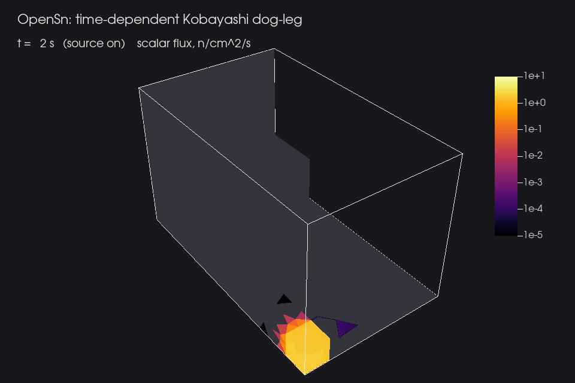
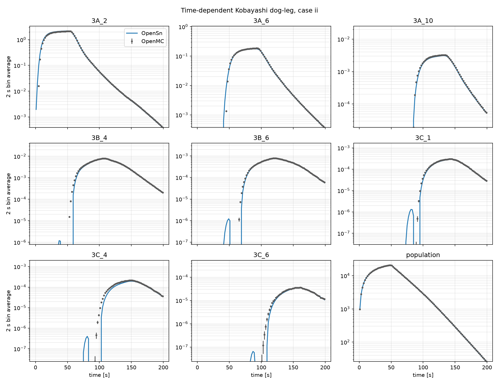

## Time-Dependent Kobayashi Dog-Leg Benchmark

This example is a 3D, one-group, time-dependent fixed-source problem: the
Kobayashi Problem 3 dog-leg duct with its source switched on for 50 s. Neutrons
stream down the void duct, turn its two bends, and are absorbed into the surrounding
shield, so the flux at the far end of the duct does not start to rise until
about 100 s.

- Benchmark: I. Variansyah, *Time-Dependent Kobayashi Dog-Leg Benchmark for
  Neutron Transport*, Zenodo (2025),
  [doi:10.5281/zenodo.15069882](https://doi.org/10.5281/zenodo.15069882), CC-BY-4.0.
- Steady-state problem: K. Kobayashi, N. Sugimura, and Y. Nagaya, "3D radiation
  transport benchmark problems and results for simple geometries with void region,"
  *Progress in Nuclear Energy* 39(2), 119-144 (2001).

<figure>
  
  <figcaption>Scalar flux from 2 s to 200 s on the source and duct, the z = 0 reflecting plane,
  and the y = 100 cm boundary where the duct exits. Gray marks flux below
  10<sup>-5</sup>, including the small negative values near the wavefront.</figcaption>
</figure>

### Problem

The problem is the $[0,60]\times[0,100]\times[0,60]$ cm with reflecting planes
at $x=0$, $y=0$, and $z=0$ and vacuum elsewhere. The 10 cm source cube sits at the
origin, and the duct runs along $+y$, then $+x$, then $+z$, then $+y$ to the outer
boundary.

| Region | Block | $\sigma_t$ [1/cm] | $c$ |
| --- | --- | --- | --- |
| Source $[0,10]^3$ | 1 | 0.1 | 0.5 |
| Duct | 2 | $10^{-4}$ | 0.5 |
| Shield | 3 | 0.1 | 0.5 |

The neutron speed is 1 cm/s. The source is 1 n/cm³/s for $0 \le t \le 50$ s, and
the benchmark reports flux in 2 s bins to $t = 200$ s.

### OpenSn model

[kobayashi_td.py](./kobayashi_td.py) solves the problem as a standard discrete-ordinates
calculation with no uncollided treatment, using PWLD on [kobayashi_dog_leg.msh](./kobayashi_dog_leg.msh), a 4,826-cell tetrahedral mesh
that conforms to the source, duct, and shield, with a 24×96 Gauss-Legendre-Chebyshev
product quadrature (2304 directions). It uses Crank-Nicolson ($\theta = 0.5$) steps of
2 s, one per benchmark bin, to 200 s. It then takes backward-Euler steps of 20 s to
500 s, which damp the remaining flux. Each step is converged to an absolute residual
of $10^{-7}$. Halving the time step changes the 2 s bin averages by 0.02% in the
population and by less than 1% at the reference points.

Run it with

```sh
mpirun -n 8 $OPENSN -i kobayashi_td.py
python3 compare_openmc.py
```

`KOBAYASHI_TD_MESH`, `KOBAYASHI_TD_QUADRATURE`, `KOBAYASHI_TD_REFINE_CONE`,
`KOBAYASHI_TD_DT`, and `KOBAYASHI_TD_THETA` override the discretization. The
quadrature is `sldfe<level>` or `glc<polar>x<azimuthal>`. For example, `sldfe0` gives
96 directions, `sldfe1` gives 384, and `sldfe1` refined within 20° of the duct axes
gives 672.

Set `KOBAYASHI_TD_VTK_INTERVAL` (seconds) to export the scalar flux up to 200 s. The
frames go to `kobayashi_td_vtk/` (or `KOBAYASHI_TD_VTK_DIR`), with a
`kobayashi_td.pvd` time index that VisIt and ParaView open as a time series. The
animation above used a 2 s interval and was made with
[render_animation.py](./render_animation.py):

```sh
KOBAYASHI_TD_VTK_INTERVAL=2 mpirun -n 8 $OPENSN -i kobayashi_td.py
visit -nowin -cli -s render_animation.py   # PNG frames in kobayashi_td_png/
python3 render_animation.py                # kobayashi_td_animation.gif (needs Pillow)
```

### Checks

1. **Time-integral identity.** Summing the theta-scheme steps gives
   $\sum_n \Delta t_n\,\phi^{n+\theta} = \phi_{ss}\!\left[\sum_n \Delta t_n\, q(t^{n+\theta})\right] - L^{-1}\tfrac{1}{v}\psi^N$,
   where $\phi_{ss}[Q]$ is the steady-state solution for a constant source $Q$ on the
   same mesh and quadrature. By 500 s the remaining population, and with it the last
   term, is negligible. The input solves the steady-state problem with $Q = 50$ and
   prints the largest relative difference from the time integral at the reference
   points and in the population as `time-integral-identity-max-rel-error`, which
   should be at the level of the iteration tolerance. It checks that the transient
   steps, source timing, and boundary treatment are consistent with the steady-state
   operator. The identity is independent of the neutron speed and the time step error.
   The Monte Carlo comparison of the population history checks those.
2. **Steady-state benchmark.** The time-integrated flux divided by 50 s tends to
   the published steady-state case-ii fluxes. `kobayashi_td_summary.csv` lists the
   ratio at each reference point. The difference is the spatial and angular error of
   the discrete-ordinates solution, including ray effects.
3. **Monte Carlo reference.** [openmc_reference.csv](./openmc_reference.csv) holds
   the OpenMC time histories from the benchmark record ($3\times10^{11}$ histories),
   averaged over 2 s bins, at the Kobayashi reference points (2 cm cube averages) and
   for the total population. [compare_openmc.py](./compare_openmc.py) compares
   these with `kobayashi_td_results.csv` and plots them. The time integral of the
   OpenMC reference divided by 50 s agrees with the steady-state case-ii fluxes to
   0.6% near the source. Along line 3C it is up to 9% lower, because flux there
   is still arriving at 200 s.

[extract_openmc_reference.py](./extract_openmc_reference.py) regenerates the reference
from the OpenMC statepoint with the most histories, `output_4.h5` in the benchmark record
(576 MB, md5 `936593f835c6127955723ff7a39d1352`).

### Results

<figure>
  
  <figcaption>Flux at selected reference points and total population, 2 s bin averages.
  OpenSn: coarse mesh, 2304 directions. OpenMC: benchmark reference with 1σ error
  bars.</figcaption>
</figure>

| Quantity | OpenSn / OpenMC |
| --- | --- |
| Population history, L1 difference | 0.07% |
| Time integral at the reference points | 0.94-1.03, except 3C_4: 0.87 |
| Point histories, L1 difference | 1-7%, except 3C_4: 13% |
| Time-integral identity, largest relative error | $1.7\times10^{-5}$ |

Point 3C_4 lies in the last duct leg, where most of its error comes from the coarse mesh. The other
point differences are mostly ray effects.

### Ray effects

The duct is nearly void, so the uncollided flux streaming down it is carried only
by the discrete directions. The result is ray effects that are strongest in the
early-time wavefront and along the far duct legs (lines 3B and 3C), and that
shrink with quadrature refinement. In the steady-state limit (time-integrated
flux over 50 s compared with the Kobayashi case-ii values) on this mesh:

| Point | 96 directions | 384 | 864 | 2304 |
| --- | --- | --- | --- | --- |
| 3A_10 | 0.49 | 1.36 | 1.13 | 0.95 |
| 3B_2 | 0.78 | 0.87 | 0.92 | 0.95 |
| 3C_6 | 0.60 | 0.98 | 0.98 | 0.96 |
