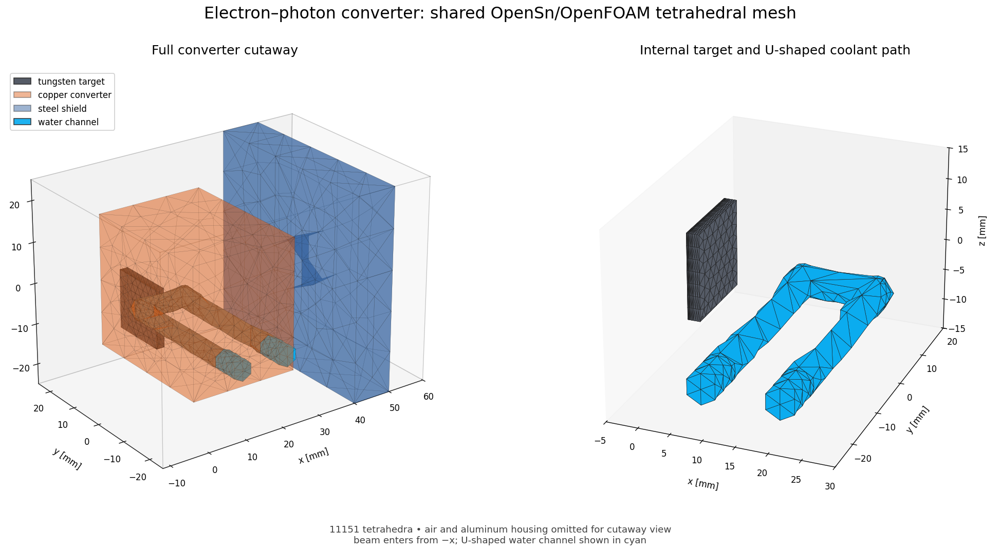
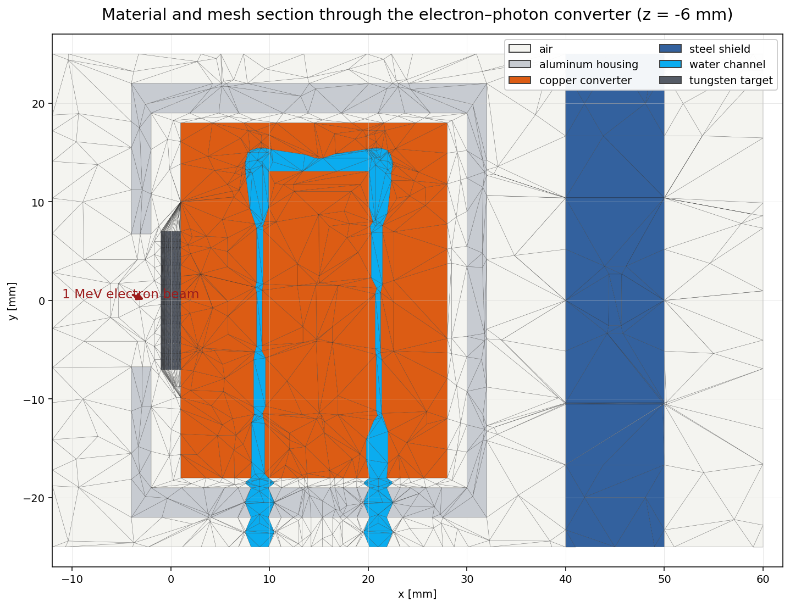

# WATERBLOCK: coupled electron-photon transport and heat transfer

WATERBLOCK is a three-dimensional OpenSn/OpenFOAM multiphysics example. A
0.1 W, 1 MeV electron beam enters an aluminum housing along the x axis, strikes
a thin tungsten target at normal incidence, and produces secondary electrons
and bremsstrahlung photons. A copper converter conducts deposited energy to a
U-shaped water channel; aluminum, air, a downstream steel plate, and the water
itself complete the six material regions. OpenSn solves coupled 20-group
electron restricted-CSDA and 20-group photon transport. preCICE transfers
cell-integrated deposited power in memory to OpenFOAM, which solves five solid
energy equations and one laminar fluid/energy region.

The checked-in Gmsh mesh has 11,151 tetrahedra. Its 3,540-cell tungsten target
is selectively refined through its thickness: four 0.1 mm layers resolve the
approximate 1 MeV electron stopping range, followed by progressively thicker
layers. OpenSn reads this mesh with its distributed mesh generator, while
OpenFOAM converts and splits the same mesh into the six regions.





## Computed answer and acceptance checks

The 16-rank, 40-group calculation deposits `0.06868668229649 W` in the
assembly, 68.69% of the incident 1 MeV/electron energy rate; the remaining
31.31% leaves through the boundaries as electrons and photons. Representative
output is:

```text
WGS groups [0-39] iteration = 524, residual = 9.664206e-08, status = converged
CSDA particle balance = 7.650882e-04
CSDA energy balance   = -5.224259e-06
WATERBLOCK_ENERGY_INFLOW_MEV_S=1.000000000000e+00
WATERBLOCK_DEPOSITION_W=6.868668229649358e-02
OpenSn deposited power  = 6.868668229649e-02 W
preCICE adapter sent    = 6.868670000000e-02 W (relative error 2.577429e-07)
OpenFOAM received power = 6.868668229649e-02 W (relative error 2.707400e-14)
baseline power          = 6.868668229649e-02 W (relative error 5.212756e-14)
```

The run is accepted when all of the following hold:

- **Energy conservation.** The CSDA energy balance and the difference between
  the integrated deposition and inflow + production - outflow are both within
  `5e-4` of the inflow. `transport.py` fails otherwise.
- **Conservative transfer.** OpenSn's volume integral of the deposition field,
  the preCICE adapter's per-cell quadrature sum, and the power OpenFOAM
  recovers after mapping agree. The OpenFOAM comparison uses `1e-10` relative;
  the adapter's logged value is compared within its printed precision.
- **Regression baseline.** The deposited power is within `1e-5` relative of
  `0.06868668229649 W`. The 8-rank result differs from the 16-rank result by
  `8.8e-7` relative, consistent with the `1e-7` iteration tolerance.

The baseline is a value from this code, not an independent reference: no Monte
Carlo or published result for this geometry is available, so these checks
detect changes and conservation errors but do not establish the accuracy of
the deposited power. The automated run advances OpenFOAM for one 0.1 s time
step to exercise all six energy equations and the fluid solve; it does not
reach a thermal steady state.

## Requirements

- OpenSn built with `OPENSN_WITH_PYTHON_MODULE=ON` and
  `OPENSN_WITH_PRECICE=ON`;
- OpenFOAM Foundation v14;
- preCICE 3.4 or newer, built against the same MPI implementation as OpenSn and
  OpenFOAM;

All three applications must use one ABI-compatible compiler/MPI stack.

## Run the coupled problem

From this directory, with the OpenFOAM environment sourced and preCICE visible
to `pkg-config`, run:

```sh
OPENSN=/path/to/opensn/build/python/opensn ./run_coupled_test.sh
```

The default is 16 OpenSn ranks and one OpenFOAM rank; the run takes about
15 minutes. Override the rank count, or the per-participant wall-clock limit
(default 3600 s), when needed:

```sh
OPENSN=/path/to/opensn OPENSN_RANKS=8 COUPLING_TIMEOUT=7200 ./run_coupled_test.sh
```

The script builds the OpenFOAM receiver, converts and splits `waterblock.msh`,
prepares all six regions, starts both participants, runs the 40-group
transport solve with iteration logging, advances OpenFOAM, and validates power
and conservation. If either participant fails or exceeds the time limit, the
script stops the other and exits with the failing status. Both participants
run on one host and connect through preCICE's default loopback interface
`lo`; set `PRECICE_NETWORK` to use another interface, for example
`PRECICE_NETWORK=lo0` on macOS. The principal logs are:

```text
meshCase/log.precice-opensn
meshCase/log.precice-openfoam
```

OpenSn also exports `waterblock_energy_deposition.pvtu` and its distributed VTU
pieces. `meshCase/` and solver output are generated files and are not tracked.

## Numerical model and coupling

The transport calculation uses all 40 energy groups in one PETSc GMRES
groupset, P2 scattering, a 26-direction order-7 Lebedev quadrature, AAH sweeps,
a GMRES restart of 300, and a `1e-7` absolute iteration tolerance. The beam is
a boundary source on the 8 mm x 8 mm `beamInlet` patch, placed on the single
quadrature direction along +x and normalized so the incident current is one
electron per second; `transport.py` rejects a quadrature without exactly one
such direction. Source quantities are scaled to the 0.1 W beam afterward.
The six cross-section libraries under `xs/` were generated by CEPXS in
Monte-Carlo-compatible mode with full electron-photon coupling, a 1 MeV
maximum energy, a 1 keV cutoff, 20 linear electron and 20 linear photon
groups and P15 Legendre moments, for densities of 19.3 (tungsten), 8.96
(copper), 2.70 (aluminum), 0.001205 (dry air), 8.00 (stainless steel 304),
and 1.00 g/cm3 (water). `transport.py` scales the cm-based cross sections to
metres.

The coupling is one-way and steady: one preCICE serial-explicit time window,
static meshes, and no temperature feedback to OpenSn. Each participant
registers one vertex at each locally owned cell center:

| preCICE name | Meaning |
| --- | --- |
| `OpenSn-Cells` | OpenSn owned-cell centroids, in metres |
| `OpenFOAM-Cells` | OpenFOAM owned-cell centers from all six regions |
| `TransportCellPower` | power deposited in one cell, W; positive heats OpenFOAM |

To avoid pointwise finite-element undershoots without clipping energy, OpenSn
volume-averages deposition over five conservative control volumes (tungsten,
three axial copper regions, and the combined low-deposition surroundings), then
integrates each owned cell to W/cell. A conservative nearest-neighbor mapping
transfers these extensive values, so the total power is preserved. The
generic multi-region OpenFOAM receiver concatenates the locally owned cell
centers from any configured number of region meshes, receives the cell powers,
and registers `Qtransport` in W/m3 by dividing by each cell volume. A coded
`fvModel` in each region adds `Qtransport` to the energy equation.

The adapter's independent manufactured test sends 1, 2, and 3 W to three
regions and recovers exactly 6 W with both one and two OpenFOAM ranks, and
checks that an incorrect expected power is rejected. Run it with:

```sh
./openfoam_adapter/tests/run.sh
```

See [`openfoam_adapter/README.md`](openfoam_adapter/README.md) for its interface
and build details.

## Regenerating the mesh

Regenerate the mesh with Gmsh and its figures with Python (`meshio`, `vtk`,
`matplotlib`, `numpy`):

```sh
GMSH_EXECUTABLE=/path/to/gmsh ./generate_mesh.sh
python3 render_geometry.py
```
