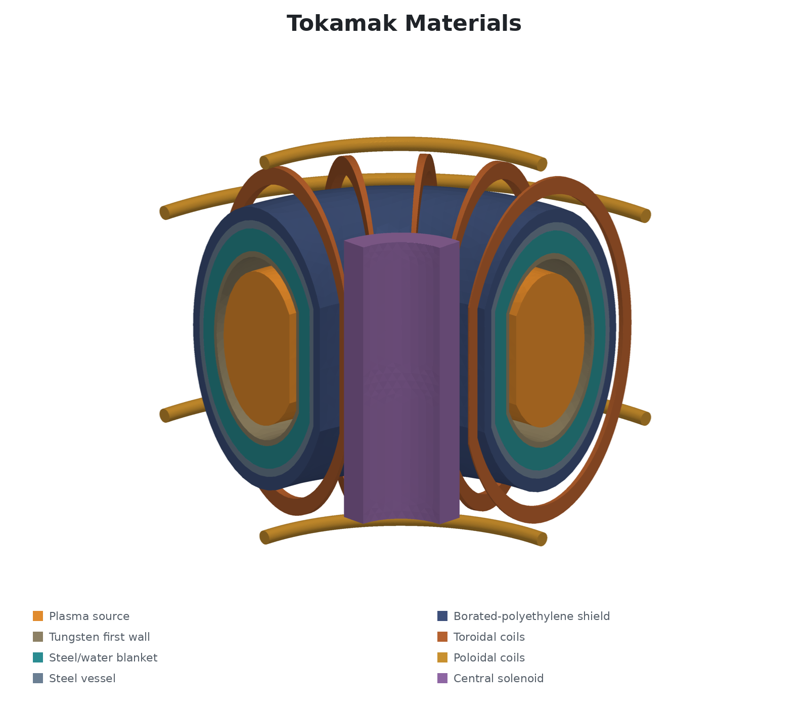
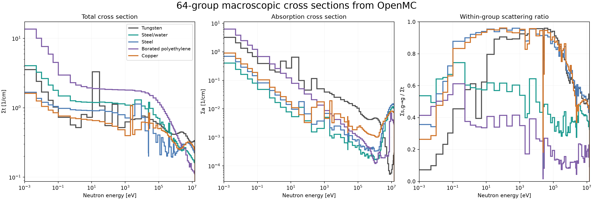
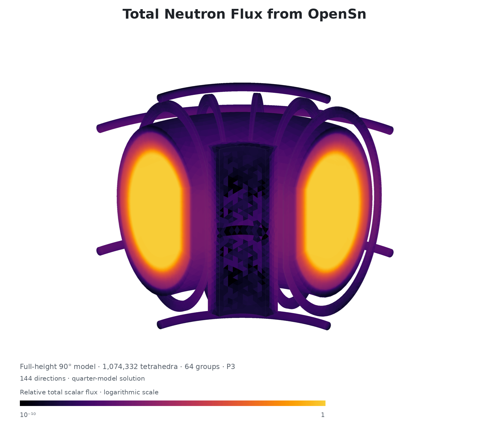
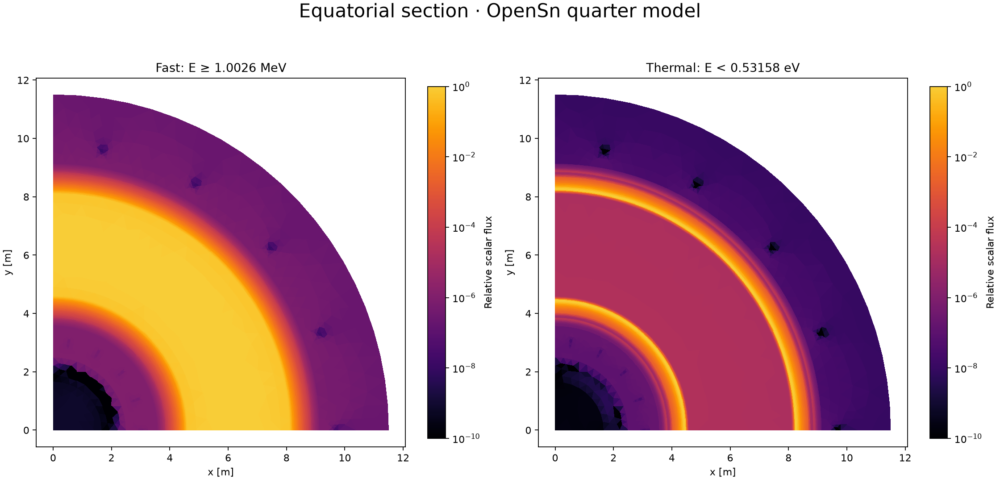
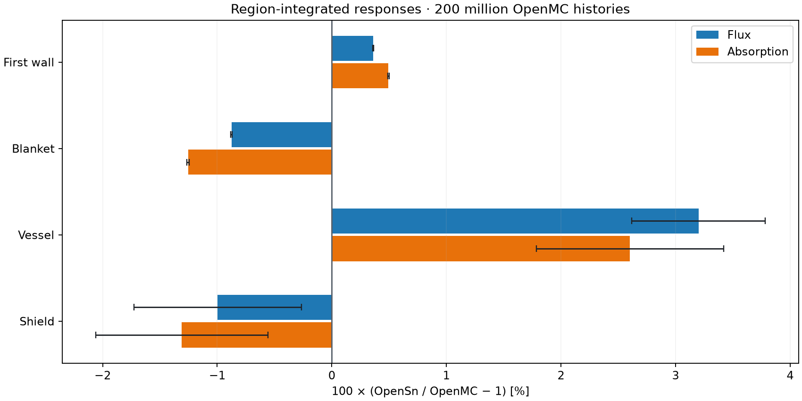
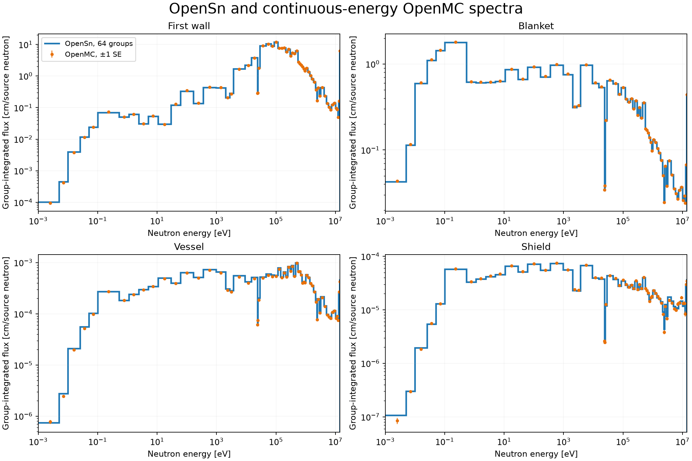

# Tokamak Fusion Engineering

**Three-dimensional deterministic neutron transport through the shield of an illustrative
tokamak, compared with continuous-energy Monte Carlo**

## Summary

This example analyzes 14.1 MeV neutron transport from the plasma of an illustrative tokamak
through its tungsten first wall, steel/water blanket, steel vessel, borated-polyethylene
shield, and copper magnet coils. OpenSn solves the steady-state multigroup transport
equation on a full-height 90° quarter of the reactor with 1,074,332 tetrahedra, 64 energy
groups, P3 scattering, and 144 discrete directions. The cross sections were generated for
this problem with OpenMC from ENDF/B-VIII.0 data, and the results are compared with a
continuous-energy OpenMC calculation of the same geometry, materials, and source.

The main findings are:

- The region-integrated flux and absorption rate agree with Monte Carlo to within 0.5% in
  the first wall and 1.3% in the blanket. In the shield, behind 76 cm of tungsten,
  steel/water, and steel, they agree to 1.0% and 1.3%, within the Monte Carlo
  uncertainty.
- The vessel flux is 3.2% higher than Monte Carlo, 5.7 standard errors. This is the
  largest discrepancy.
- The group spectra in the four compared regions agree with Monte Carlo to 0.9% to 4.4%
  root mean square, from the thermal peak to the source energy.
- Angular quadrature and iteration tolerance contribute less than 0.15% to the compared
  responses. P3 scattering is necessary: P2 changes the vessel and shield flux by 6% to 9%.
- On 480 CPU cores the calculation takes 15 minutes, 12 of them in the solve. Within-group
  diffusion synthetic acceleration (WGDSA) cuts the iterations from 114 to 52 and the CPU
  cost by a factor of 1.9, without changing the compared results.

## Contents

- [Problem description](#problem-description)
- [Nuclear data](#nuclear-data)
- [Transport model](#transport-model)
- [Results](#results)
- [Comparison with continuous-energy Monte Carlo](#comparison-with-continuous-energy-monte-carlo)
- [Discussion](#discussion)
- [Conclusions](#conclusions)
- [Appendix: reproducing the results](#appendix-reproducing-the-results)

## Problem description

### Geometry

The reactor is a set of nested D-shaped toroidal shells around a plasma, with 18 toroidal
field coils, four poloidal field coils, and a central solenoid. The model is the quarter
`0 ≤ φ ≤ 90°` of the reactor over its full height, `−690 ≤ z ≤ 690 cm`, inside the cylinder
`R ≤ 1150 cm`, where `R = sqrt(x² + y²)`. The reactor has no ports, so the quarter with
reflecting planes at `x = 0` and `y = 0` represents the whole reactor exactly. The outer
cylinder and the top and bottom planes are vacuum boundaries.

<picture>
  <source media="(prefers-color-scheme: dark)" srcset="assets/geometry-dark.png">
  
</picture>

*Figure 1. Material regions of the quarter model.*

The shells are bounded by the envelopes

$$
\left(R-620\right)^2 + \left(z/1.55\right)^2 < a^2,
\qquad R > R_{\mathrm{cut}},
$$

with lengths in cm. Each layer is the space between two successive envelopes.

*Table 1. Regions, dimensions, and materials.*

| Block | Region | Outer envelope `a` / `R_cut` [cm] | Material, density [g/cm³] |
| --- | --- | --- | --- |
| 1 | Plasma source | 160 / 490 | Void with a neutron source |
| 2 | Vacuum chamber | 190 / 460 | Void |
| 3 | First wall | 202 / 448 | Natural tungsten, 19.25 |
| 4 | Blanket | 249 / 401 | 50/50 steel/water by volume, 4.499 |
| 5 | Vessel | 266 / 384 | Steel, 8.0 |
| 6 | Shield | 294 / 356 | Polyethylene with 5 wt% natural boron, 0.968987 |
| 7 | Toroidal coils | D-shaped coil wedges | Natural copper, 8.96 |
| 8 | Poloidal coils | Four toroidal rings | Natural copper, 8.96 |
| 9 | Central solenoid | `165 < R < 250`, `−450 < z < 450` | Natural copper, 8.96 |
| 10 | Exterior | Remaining domain | Void |

The 18 toroidal coils are spaced 20° apart and are each 0.04 radians wide, so the quarter
holds 4.5 coils. The poloidal coils have a 22 cm minor radius and centers
`(R, z) = (600, ±610)` and `(1040, ±330)` cm.

### Materials

All materials are at 293.6 K. The steel is an idealized Fe/Cr/Ni/Mo alloy with mass
fractions 0.685/0.17/0.12/0.025, not certified SS316L. The blanket is a homogeneous
50/50 mixture by volume of that steel and light water. The shield is polyethylene with
5 wt% natural boron. [openmc_reference.py](openmc_reference.py) gives the complete
nuclide compositions and thermal scattering treatments.

### Source

The source is isotropic and monoenergetic at 14.1 MeV, with a uniform density of
1 neutron/(cm³ s) throughout the plasma region. All results are normalized per source
neutron. The meshed plasma volume is 116,634,375 cm³, 0.29% smaller than the analytic
volume of 116,974,330 cm³ because the mesh facets the curved surfaces. The normalization
per source neutron removes this difference from the source strength. The meshed volumes of
the other regions differ from the analytic volumes by 0.01% to 0.48%.

## Nuclear data

The 64-group library `materials_64g_p3.h5` was generated for this problem with OpenMC from
ENDF/B-VIII.0 continuous-energy data by [generate_xs.py](generate_xs.py). The groups span
0 to 14.191 MeV. They are a subset of the VITAMIN-J 175-group boundaries with four thermal
boundaries added below 0.1 eV. Group 0, from 13.84 to 14.191 MeV, contains the source.

Each material is weighted by its own spectrum in this problem. OpenMC tallies the
tungsten, steel/water, steel, and borated-polyethylene cross sections in those regions of
the continuous-energy model, with 10⁹ analog source neutrons. Too few neutrons reach the
copper coils behind the shield to tally all 64 groups there, so copper is weighted in a
stochastic slab instead: 1 cm layers of all five materials in a fixed random order, with a
14.1 MeV source.

The library holds the total and physical absorption cross sections and the P0 to P3
neutron-production scattering matrices, which include (n,2n) and other multiplying
reactions. OpenMC's consistent scattering estimator makes the P0 scattering cross section
equal to the total minus the absorption cross section. No transport correction or other
adjustment is applied.

<picture>
  <source media="(prefers-color-scheme: dark)" srcset="assets/cross-sections-dark.png">
  
</picture>

*Figure 2. Macroscopic total and absorption cross sections and within-group scattering
ratio `Σs,g→g / Σt` of each material. Between about 100 eV and 100 keV, the within-group
ratio of steel, copper, and tungsten is mostly above 0.9, and they absorb very little.
The borated polyethylene moderates strongly, so its within-group ratio stays below about
0.6.*

*Table 2. Weighting and statistical quality of the group cross sections.*

| Material | Weighting spectrum | Median statistical error of the group total cross sections |
| --- | --- | ---: |
| Tungsten | Tokamak | 0.025% |
| Steel/water | Tokamak | 0.020% |
| Steel | Tokamak | 1.0% |
| Borated polyethylene | Tokamak | 1.7% |
| Copper | Stochastic slab | 0.07% |

[provenance/materials_64g_p3.json](provenance/materials_64g_p3.json) records the OpenMC
version and commit, the SHA-256 of every nuclear data file, of the generating scripts, of
the OpenMC inputs and statepoints, and of the library, and the statistical quality of every
material. With the same OpenMC build and nuclear data, the library is reproduced bit for
bit.

## Transport model

*Table 3. OpenSn discretization and solver.*

| Setting | Value |
| --- | --- |
| Mesh | 1,074,332 linear tetrahedra |
| Spatial discretization | Piecewise-linear discontinuous (PWLD) |
| Energy | 64 groups, 0 to 14.191 MeV |
| Scattering | P3, 16 flux moments |
| Angular quadrature | Gauss-Legendre-Chebyshev, 6 polar × 24 azimuthal = 144 directions |
| Sweep | AAH |
| Linear solver | PETSc flexible GMRES (FGMRES) on one groupset, restart length 10 |
| Acceleration | Within-group DSA, diffusion solves to a relative residual of `1e-1` in at most 5 iterations |
| Convergence | `1e-8` relative residual |

The mesh resolves the first wall in 1 cm layers and the blanket, vessel, and shield in
2 cm layers to follow the steep attenuation of the flux. The upper half of the quarter
was meshed with Gmsh and mirrored through `z = 0`, so the mesh is symmetric about the
midplane.

### Sensitivity to the discretization

Table 4 shows how coarser and finer angular quadratures and lower scattering orders change
the deepest compared responses, relative to the settings in Table 3.

*Table 4. Change of the vessel and shield flux with other settings.*

| Change | Vessel flux | Shield flux |
| --- | ---: | ---: |
| 288 directions (8 × 36) | +0.09% | +0.12% |
| 480 directions (10 × 48) | +0.06% | +0.08% |
| 64 directions (4 × 16) | −1.25% | −1.58% |
| P2 scattering | −6.2% | −8.5% |
| P1 scattering | −49% | −55% |

The 144-direction quadrature is converged to about 0.1% for these responses, while 64
directions are not. The scattering order matters much more. The neutrons that reach the
vessel and shield have scattered strongly forward at high energy, and truncating the
scattering to P2 or P1 underestimates their penetration by 6% to 55%. A tolerance tighter
than `1e-8` changes the results by less than 0.01%.

### Iterative convergence

Without acceleration, GMRES converges in 114 iterations on 384 CPU ranks. The slowly
converging error is the within-group diffusive mode in the optically thick, nearly pure
scatterers of Figure 2: steel, copper, and tungsten in the intermediate energy range.
Solving the 16 thermal groups, the only groups that receive upscatter, in a separate
groupset does not reduce the work, because the intermediate-energy groups need as many
iterations as the full set.

Within-group diffusion synthetic acceleration targets this mode. Each FGMRES iteration
applies one diffusion correction per group, solved only to a relative residual of `1e-1`.
Because these inexact solves make the preconditioner change slightly from one iteration to
the next, the outer method must be flexible GMRES. With WGDSA the calculation converges in
52 iterations on 480 CPU ranks. Each iteration takes about 15% more core time than an
unaccelerated one, because the diffusion solves use all CPU cores. The solve takes 5,750
core-minutes instead of 10,900, a factor of 1.9.

WGDSA does not change the compared responses. The first wall, blanket, vessel, and shield
results agree with the unaccelerated solution to `4e-5` or better. The coils and the
exterior differ by up to 0.8%.
At the `1e-8` tolerance these deep regions are converged only to about 1%, because the
convergence test measures the residual over the whole problem.

Two-grid DSA does not reduce the iterations.

Partition boundaries add lagged angular fluxes to the AAH sweep, 3.3% of the angular
unknowns on 480 ranks. More ranks therefore need slightly more iterations.

## Results

The particle balance closes to a relative defect of `2.0e-7`, consistent with the `1e-8`
iteration tolerance. Only `9.2e-7` of the source neutrons leak through the vacuum
boundaries. The materials include neutron-multiplying reactions such as (n,2n), so the
absorption rate can exceed one per source neutron. It is 1.89 per source neutron in total,
and 71% of it is in the tungsten first wall.

*Table 5. Region-integrated scalar flux [cm] and absorption rate per source neutron.*

| Region | Flux | Absorption |
| --- | ---: | ---: |
| Plasma source | 1298.1 | 0 |
| Vacuum chamber | 523.99 | 0 |
| First wall | 137.54 | 1.3498 |
| Blanket | 23.089 | 0.53932 |
| Vessel | 2.3848e-2 | 1.3972e-4 |
| Shield | 1.6524e-3 | 1.2133e-4 |
| Toroidal coils | 1.3685e-5 | 5.0323e-8 |
| Poloidal coils | 2.4411e-6 | 7.5757e-9 |
| Central solenoid | 3.2901e-5 | 1.2118e-7 |
| Exterior | 5.1580e-4 | 0 |

<picture>
  <source media="(prefers-color-scheme: dark)" srcset="assets/quarter-flux-dark.png">
  
</picture>

*Figure 3. Total scalar flux on the surfaces of the quarter model, relative to its maximum,
on a logarithmic scale down to `1e-10`.*

The fast flux is highest in the plasma and falls steadily through the layers. The thermal
flux peaks in the steel/water blanket, where the water slows the fast neutrons down.

<picture>
  <source media="(prefers-color-scheme: dark)" srcset="assets/energy-bands-dark.png">
  
</picture>

*Figure 4. Fast (`E ≥ 1.0026 MeV`) and thermal (`E < 0.53158 eV`) flux on the midplane
`z = 0`. Each field is normalized by its maximum and shown on a logarithmic scale down to
`1e-10`. The copper coils and the central solenoid appear as darker patches.*

## Comparison with continuous-energy Monte Carlo

The reference is an OpenMC calculation with continuous-energy ENDF/B-VIII.0 cross sections
on the analytic geometry, with the same materials, source, and boundary conditions. It
averages two analog runs of 100 million histories each, with seeds 491211 and 491213. The
reference does not share any approximation with OpenSn except the nuclear data evaluation.
The uncertainties are one standard error (SE) of the mean.

*Table 6. Region-integrated flux [cm] and absorption per source neutron.*

| Region | OpenSn flux | OpenMC flux | Difference | OpenSn absorption | OpenMC absorption | Difference |
| --- | ---: | ---: | ---: | ---: | ---: | ---: |
| First wall | 137.54 | 137.04 ± 0.004% | +0.36% | 1.3498 | 1.3432 ± 0.005% | +0.49% |
| Blanket | 23.089 | 23.293 ± 0.007% | −0.88% | 0.53932 | 0.54618 ± 0.011% | −1.25% |
| Vessel | 2.3848e-2 | 2.3108e-2 ± 0.56% | +3.20% | 1.3972e-4 | 1.3617e-4 ± 0.80% | +2.60% |
| Shield | 1.6524e-3 | 1.6690e-3 ± 0.74% | −1.00% | 1.2133e-4 | 1.2294e-4 ± 0.76% | −1.31% |

<picture>
  <source media="(prefers-color-scheme: dark)" srcset="assets/openmc-comparison-dark.png">
  
</picture>

*Figure 5. Relative difference of the OpenSn responses from OpenMC. Error bars show one
OpenMC standard error. They do not include the OpenSn discretization errors.*

The first wall and the blanket agree with OpenMC to about 1%. OpenMC resolves them to
0.01%, so these differences are systematic. The shield flux and absorption differ by 1.3
and 1.7 standard errors, within the Monte Carlo uncertainty. The vessel flux is high by
3.2%, 5.7 standard errors, and its absorption by 2.6%, 3.3 standard errors.

<picture>
  <source media="(prefers-color-scheme: dark)" srcset="assets/openmc-spectra-dark.png">
  
</picture>

*Figure 6. Group-integrated flux per source neutron in each region. These are integrals
over each group, not flux per unit energy or lethargy. OpenMC markers show ±1 standard
error.*

*Table 7. Agreement of the group spectra, over the groups whose OpenMC standard error is
below 5%.*

| Region | Groups compared | RMS group difference | Largest group difference |
| --- | ---: | ---: | ---: |
| First wall | 64 | 2.3% | 8.5% (lowest-energy group) |
| Blanket | 64 | 0.9% | 2.2% |
| Vessel | 62 | 4.4% | 10.6% |
| Shield | 45 | 3.4% | 9.7% |

The spectra follow OpenMC from the thermal peak to the source group. The deepest dip in
Figure 6, near 24 keV, is a narrow group from 24.18 to 24.79 keV, not a drop in the flux
per unit energy.

The coils and the exterior are reached by so few Monte Carlo histories that their OpenMC
standard errors are 9% to 30%. They are not compared. The OpenSn values for them in
Table 5 are unverified and converged only to about 1% (see
[Iterative convergence](#iterative-convergence)).

## Discussion

### Sources of the remaining differences

Because the quadrature and the iteration tolerance contribute less than 0.15% (Table 4),
the differences in Table 6 come from approximations that the two calculations do not
share:

- the multigroup approximation, with 64 groups and cross sections weighted by
  region-averaged spectra,
- the truncation of the scattering anisotropy to P3,
- the PWLD spatial discretization on the mesh of Table 3, and
- the faceted representation of the curved surfaces.

No mesh refinement or higher-order scattering calculation has been done, so the separate
sizes of these contributions are not known. The vessel difference in particular is
significant, and finding its cause requires those studies. Agreement of region totals does
not imply equally small errors in every group or at every point, as Table 7 shows.

### Computational cost

*Table 8. Measured cost of the OpenSn calculation on the CPU.*

| Configuration | Hardware | Iterations | Solve | Total | Peak host memory |
| --- | --- | ---: | ---: | ---: | ---: |
| CPU, FGMRES with WGDSA | 480 CPU cores | 52 | 12.0 min | 15.0 min | 2.2 TB |
| CPU, GMRES | 384 CPU cores | 114 | 28.4 min | 31.2 min | 1.2 TB |

*The total includes reading and distributing the mesh, building the sweep data, and
writing the results.*

Each copy of the P3 flux moments takes about 35 GB, and GMRES keeps about a dozen of them.
FGMRES keeps a second set of Krylov vectors, and the diffusion solver adds its matrices and
multigrid hierarchy, so WGDSA needs about 1 TB more memory. The run time is
dominated by work that grows with the number of flux moments, so P3 costs much more than
P1 at the same quadrature.

The deterministic solution gives the flux in every group, moment, and cell, including the
deep coil regions that the 200-million-history Monte Carlo reference resolves only to 9% to
30%. Reducing those Monte Carlo uncertainties to a few percent with analog Monte Carlo
would take tens to hundreds of times more histories.

## Conclusions

On a full-height three-dimensional tokamak model, OpenSn reproduces a continuous-energy
Monte Carlo reference to about 1% in the first wall, blanket, and shield, and to 3.2% in
the vessel, through 104 cm of shielding materials. The group spectra agree to
0.9% to 4.4% root mean square. The results are converged in angle and iteration to about
0.1%, but P3 scattering is essential. The remaining differences come from the multigroup,
scattering-truncation, and spatial approximations, and separating them requires mesh and
scattering-order refinement studies. The calculation runs in 15 minutes on 480 CPU cores
with within-group DSA, which halves its cost.

## Appendix: reproducing the results

### Files

| File | Purpose |
| --- | --- |
| [tokamak.py](tokamak.py) | OpenSn input |
| `tokamak.msh.gz` | Compressed Gmsh mesh |
| `materials_64g_p3.h5` | 64-group P3 macroscopic cross sections in OpenMC format |
| [openmc_reference.py](openmc_reference.py) | Continuous-energy OpenMC model of the same problem |
| [generate_xs.py](generate_xs.py) | Script that generates the cross sections with OpenMC |
| [generate_mesh.py](generate_mesh.py) | Script that generates the mesh with Gmsh |
| [provenance/materials_64g_p3.json](provenance/materials_64g_p3.json) | Record of every input and output of the cross-section generation |
| `assets/` | Figures of this report |

### Running OpenSn

These results were computed with version `22d12f739c4863ac9f3966010451363effcc2e20` of OpenSn. The
calculation needs large-scale resources, so it is not part of the automated example tests.

Run one MPI rank per CPU core:

```sh
gunzip -k tokamak.msh.gz
export OPENSN_NUM_THREADS=1
srun -n 480 opensn -i tokamak.py
```

Rank 0 prints the particle balance and Table 5. The scalar flux of every group is written
to `tokamak_flux.pvtu` and one `.vtu` piece per rank. The arrays `phi_gGGG_m00` hold the
scalar flux of group `GGG`, numbered from the highest energy. The figures were made from
these files with PyVista and Matplotlib, using the mean of the four PWLD nodal values of
each tetrahedron.

### Running the OpenMC reference

[openmc_reference.py](openmc_reference.py) builds the OpenMC model, runs it, and prints
the same region table as [tokamak.py](tokamak.py). It needs continuous-energy
ENDF/B-VIII.0 data for the nuclides and thermal scattering tables listed in
[provenance/materials_64g_p3.json](provenance/materials_64g_p3.json). These data are not
included.

```sh
export OPENMC_CROSS_SECTIONS=/path/to/cross_sections.xml
python3 openmc_reference.py --seed 491211 --processes 32
python3 openmc_reference.py --seed 491213 --processes 32
```

Each run writes its input and statepoint to `openmc_seed<seed>/`. The defaults are the 5
million histories per batch and 20 batches used for the reference.

### Regenerating the cross sections

```sh
export OPENMC_CROSS_SECTIONS=/path/to/endfb-viii.0-hdf5/cross_sections.xml
python3 generate_xs.py --processes 32
```

This takes about 2.5 hours on 32 cores and reproduces `materials_64g_p3.h5` bit for bit
with the OpenMC build and nuclear data recorded in the provenance file. OpenSn needs only
the library.

### Regenerating the mesh

```sh
python3 generate_mesh.py --output tokamak.msh
```

The script needs the `gmsh`, `meshio`, and `numpy` Python packages. The supplied mesh was
made with Gmsh 4.15.2. Gmsh does not mesh this geometry reliably: with Gmsh 4.15.2 most
runs fail during 3D boundary recovery, and a run that succeeds gives a slightly different
mesh on another machine. The script stops if Gmsh fails or returns inverted tetrahedra, so
a mesh it writes is valid, but it will not match the supplied one.

## License

The example and its geometry are distributed under the repository's MIT license.
