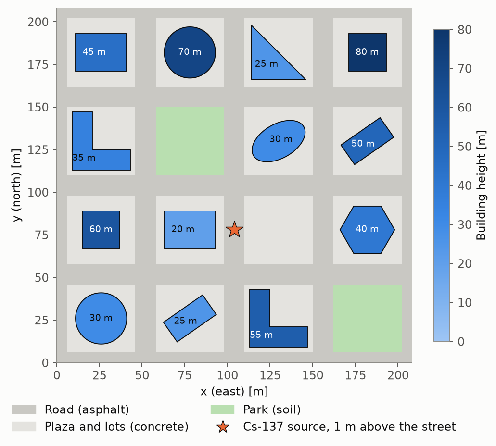
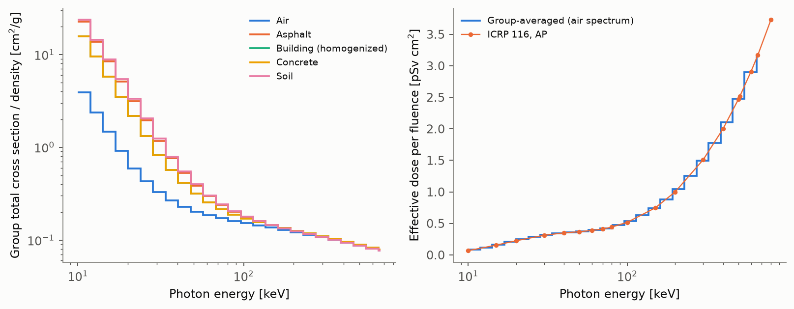
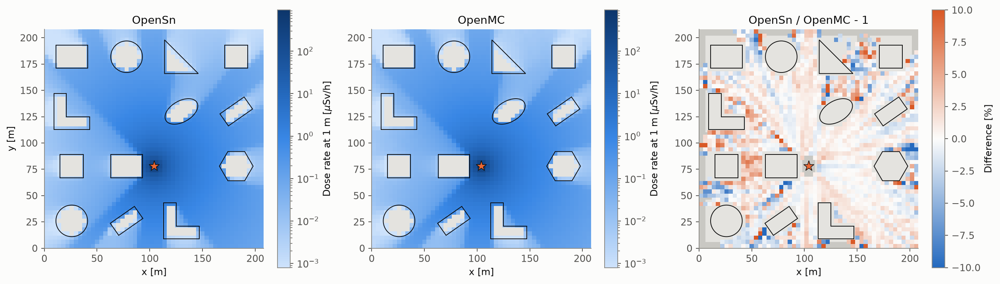
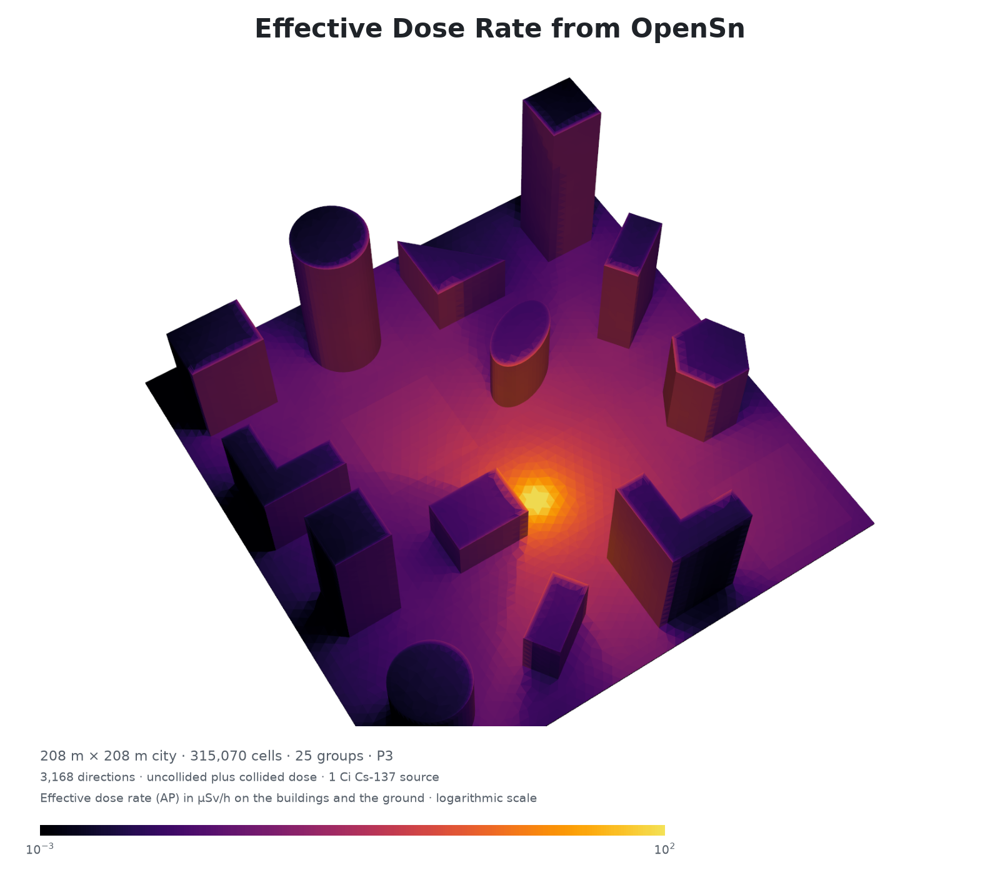

# Urban Source

**Three-dimensional gamma-ray transport from a Cs-137 point source in a city, compared with
continuous-energy Monte Carlo**

## Summary

This example computes the dose rate around a Cs-137 gamma-ray source on a city street: the
661.657 keV photons travel through the air, scatter from the buildings, the pavement, and the
ground, and reach the streets, the plaza, and the parks around the source. The city is
described by a layout file, [city.toml](city.toml), as a lattice of streets, plazas, parks, and
buildings of several shapes and heights, so that a new city can be made by editing a few lines.
The same file builds the OpenSn mesh and the analytic geometry of the OpenMC reference.

The source is a point in a large, optically thin domain, so OpenSn computes the uncollided flux
by ray tracing from the source and solves only for the collided flux with the
discrete-ordinates method. The calculation uses 25 photon energy groups. The cross sections were
generated for this problem with OpenMC from ENDF/B-VIII.0 photon data, and the results are
compared with a continuous-energy OpenMC calculation of the same city, materials, and source.

The main findings are:

- The total dose in the air agrees with OpenMC to 0.13%, and the collided flux in the air
  to 0.46%. The leakage from the city agrees to 0.44%.
- On the dose-rate map 1 m above the ground, the median difference from OpenMC is 1.0% in
  the boxes that see the source and 2.4% in the shadows of the buildings, and the mean
  differences are +0.32% and +0.30%. In the boxes that see the source, the RMS difference
  is 1.6% beyond the statistical error of OpenMC.
- The collided flux is computed with 3,168 directions, refined near the horizon. With 576
  directions, ray effects of the collided flux made streaks of alternating sign on the dose
  map. The 3,168 directions halve them: the 95th percentile of the difference of the
  collided dose in the boxes that see the source falls from 21% to 11%.
- The uncollided flux agrees with semi-analytic integrals to 0.03% in the air and the
  streets. In the buildings and the plaza, the uncollided flux of OpenSn agrees with that
  of OpenMC to 0.7%.
- Three parts of the discretization control the accuracy. The ground must be meshed in
  layers a few centimeters thick at its surface, because the gamma rays scattered back
  from it are three quarters of the scattered flux in the air. The walls of the buildings need
  layers thinner than the 0.5 m mean free path in them. The angular quadrature needs
  directions near the horizon. A product quadrature with 8 polar angles, on a mesh
  without the wall layers, made the dose map 8% low in the boxes that see the source and
  13% low in the shadows.
- The 25-group library is not a significant source of error. A multigroup Monte Carlo
  calculation with the same group data agrees with continuous-energy OpenMC to 0.2% in
  the region totals and in the mean of the dose map.
- The uncollided flux took 4 minutes on one MPI rank with 32 threads. The collided flux
  took 88 GMRES iterations and 48 minutes on 960 MPI ranks, with 940 GB of memory. With
  576 directions, it took 83 minutes on 24 MPI ranks of one node, with 227 GB.

## Contents

- [Problem description](#problem-description)
- [Designing a city](#designing-a-city)
- [Nuclear data](#nuclear-data)
- [Transport model](#transport-model)
- [Results](#results)
- [Comparison with continuous-energy Monte Carlo](#comparison-with-continuous-energy-monte-carlo)
- [Discussion](#discussion)
- [Conclusions](#conclusions)
- [Appendix: reproducing the results](#appendix-reproducing-the-results)

## Problem description

### Geometry

The city covers 208 m by 208 m. It is a lattice of 40 m lots separated by 12 m streets, with a
6 m half street along each edge. Thirteen lots hold a building, two hold a park, and one is an
open plaza. The buildings are rectangles, a rotated rectangle, circles, an ellipse, a hexagon, a
triangle, and two L shapes in plan, from 20 m to 80 m tall. The ground is a 1 m slab below the
streets and lots, and the air extends 150 m above it. All the outer surfaces of the domain are
vacuum boundaries.

<picture>
  <source media="(prefers-color-scheme: dark)" srcset="assets/geometry-dark.png">
  
</picture>

*Figure 1. Plan of the city. The buildings are colored by height. The star marks the source,
1 m above the street between the 20 m building and the plaza.*

### Materials

The compositions and densities of the air, the asphalt pavement, the ordinary concrete, and the
soil are entries 4, 20, 107, and 116 of the *Compendium of Material Composition Data for
Radiation Transport Modeling*, PNNL-15870, Rev. 2 (2021).

*Table 1. Materials.*

| Material | Used for | Density [g/cm³] |
| --- | --- | ---: |
| Air (dry, near sea level) | The air | 0.001205 |
| Building | The buildings | 0.23 |
| Concrete, ordinary (NIST) | The plaza and the lots around the buildings | 2.3 |
| Asphalt pavement | The streets | 2.5784 |
| Earth, U.S. average | The parks | 1.52 |

The buildings are homogenized: the concrete of their walls and floors is spread over their
whole volume, as if it filled 10% of it, which gives the mass per volume of a typical concrete
building. The photons therefore enter the buildings and scatter inside them, instead of
reflecting from a solid concrete block. A homogenized building attenuates the 661.657 keV
photons with a mean free path of 0.55 m, so photons cross the thin parts of the buildings, near
their corners, but not their full width.

### Source

The source is a point at (104, 78, 1) m that emits the 661.657 keV gamma ray of the decay of
Cs-137 through Ba-137m isotropically. Results are given per source photon and as dose rates for
a source of 1 Ci (3.7 × 10¹⁰ Bq), which emits 0.8510 photons of 661.657 keV per decay, or
3.149 × 10¹⁰ photons/s. The x rays of Ba-137m, near 32 keV, are not included.

## Designing a city

[city.toml](city.toml) describes the whole problem except the transport settings: the lattice,
the building types, the ground types, the materials, the source, and the dose map. Lengths are
in meters, x points east, y points north, and the ground surface is z = 0.

The lattice is a list of column widths from west to east, a list of row widths from south to
north, and the rows themselves, written from north to south as on a map, with one token per
column:

```toml
[lattice]
x_widths = [6.0, 40.0, 12.0, 40.0, 12.0, 40.0, 12.0, 40.0, 6.0]
y_widths = [6.0, 40.0, 12.0, 40.0, 12.0, 40.0, 12.0, 40.0, 6.0]
rows = [
    "=   =   =   =   =   =   =   =   =",
    "=  R45  =  C70  =  T25  =  S80  =",
    ...
]
```

A token is either a ground type (`=` road, `.` plaza, `P` park), or a building type followed by
the height of that building in meters: `R45` is a building of type `R`, 45 m tall. Building
types are defined once and used in any number of lots, each with its own height:

```toml
[buildings.E]
shape = "ellipse"
semi_axes = [17.0, 10.0]
rotation = 30.0
```

The shapes are `rectangle` (`width`, `depth`), `circle` (`radius`), `ellipse` (`semi_axes`),
`regular_polygon` (`sides`, `radius`), and `polygon` (`points`, counterclockwise, relative to
the center of the lot, convex or not). Every footprint is centered on its lot, rotated
counterclockwise by `rotation` degrees, and must stay at least 1 m inside the lot. A building
type can also set `material`, the material that fills it, and `lot_material`, the ground of its
lot. `[building_defaults]` gives the values for types that do not. A ground type sets the
`token` that marks it in the lattice and its `material`. New materials are added under
`[materials]` with a density and elemental weight fractions.

[city.py](city.py) reads the layout, checks it, and reports what is wrong with it: a building
that overlaps the edge of its lot, a self-intersecting polygon, a source inside a building or
too close to a surface, or a material that is not defined. Run it to see the blocks of the mesh:

```sh
python3 city.py
```

After changing the layout, run [generate_mesh.py](generate_mesh.py) and the two stages of
[urban_source.py](urban_source.py) again, and [openmc_reference.py](openmc_reference.py) for the
reference. [generate_xs.py](generate_xs.py) needs to be run again only when a material is added
or changed, because the cross sections of each material do not depend on the geometry.

## Nuclear data

### Group cross sections

The 25-group library `materials_25g_p7.h5` was generated with OpenMC from ENDF/B-VIII.0 photon
data by [generate_xs.py](generate_xs.py). Group 0, from 650 to 670 keV, holds the 661.657 keV
source line. The 24 groups below it are equally spaced in lethargy from 650 keV down to 10 keV.
Photons below 10 keV are absorbed, in both the library and the OpenMC reference: in air they
travel less than 2 m, and the dose coefficients start at 10 keV.

Each material is weighted in its own infinite medium, a reflecting cube filled with that
material. 99% of the source is at 661.657 keV and 1% is spread over the group structure with a
1/E spectrum, so that every group is sampled. The electrons are absorbed where they are
produced, so no bremsstrahlung is made, and the fluorescence x rays of these light materials
are all below 10 keV. Every photon in the problem is therefore a source photon or one of its
scattered descendants, and there is no photon production.

For each group the library holds the total cross section, P0 to P7 Legendre moments of the
scattering matrix, and an absorption cross section that includes photoelectric absorption and
scattering to below 10 keV. The scattering cross section of each group comes from a
track-length estimator, and an analog estimator gives the probabilities of scattering to each
group and their Legendre moments, so the P0 scattering plus the absorption equal the total
cross section exactly. Compton scattering only lowers the photon energy, and coherent
scattering keeps a photon in its group, so the scattering matrix has no upscattering.

<picture>
  <source media="(prefers-color-scheme: dark)" srcset="assets/cross-sections-dark.png">
  
</picture>

*Figure 2. Left: group total cross sections divided by density. Above 100 keV, Compton
scattering makes them nearly equal for all the materials. Below, photoelectric absorption
grows with the atomic number. The buildings are made of concrete, so their curve is hidden
under that of the concrete. Right: the group-averaged effective-dose coefficients of the
library and the ICRP 116 values.*

The group-0 cross sections agree with the continuous-energy values at 661.657 keV. For air, the
group-0 mass attenuation coefficient is 0.07707 cm²/g, and the ENDF/B-VIII.0 value at the source
energy is 0.07706 cm²/g.

[provenance/materials_25g_p7.json](provenance/materials_25g_p7.json) records the OpenMC version
and commit, the SHA-256 of every nuclear data file, of the generating scripts, of the OpenMC
inputs and statepoints, and of the library, and the statistical quality of every material.

### Dose

The dose is the effective dose of ICRP Publication 116 for the anterior-posterior (AP)
irradiation geometry, a standing person facing the source. OpenMC folds the pointwise
coefficients into its tallies, interpolated log-log in energy. OpenSn multiplies the group flux
by group-averaged coefficients, weighted by the photon spectrum of an infinite air medium, which
the library stores as the dataset `dose_ap` of every material. The isotropic (ISO) coefficients
are stored as `dose_iso`.

## Transport model

### Uncollided and collided flux

A point source in a large domain of air is a worst case for the discrete-ordinates method:
the flux streams from the source along the discrete directions only, and ray effects
dominate the solution. OpenSn splits the flux into an uncollided and a collided part. The
uncollided flux, `exp(-τ)/(4π s²)` at distance `s` from the source, is computed by ray
tracing. Its first collisions are the source of a discrete-ordinates calculation of the
collided flux, which is spread over the city and smooth, and the uncollided flux is added
back to the result.

The two parts are computed in two runs of [urban_source.py](urban_source.py). The first runs
on one MPI rank, with threads, and writes the uncollided flux moments to
`urban_source_uncollided.h5`. The second reads them on any number of ranks and solves for
the collided flux. The uncollided flux is ray traced from the source to the quadrature
points of every cell of the mesh. A sweep along the directions from the source would be
cheaper, but it cannot attenuate the flux across the buildings, which are many mean free
paths thick and meshed with cells much larger than a mean free path in their interiors.
The cells around the source cell are integrated exactly over direction. The source sits at
the centroid of a regular tetrahedron with 1 m edges that
[generate_mesh.py](generate_mesh.py) embeds in the mesh, so it is far from every face, edge,
and vertex.

### Mesh

The mesh has 315,070 cells. The air is meshed with tetrahedra that are 1 m at the source,
4 m at the ground and at the walls and roofs, and up to 24 m away from them. Two parts of
the mesh need layers much thinner than these tetrahedra:

- **The ground.** The ground is meshed with 81,746 prisms in 7 layers, 2 cm thick at the
  surface and 48 cm at the bottom of the 1 m slab. Most of the gamma rays that reach the
  ground collide within a few centimeters of its surface, and the gamma rays scattered
  back from that skin are three quarters of the scattered flux in the air. On a test slab
  of concrete, cells 50 cm thick at the ground surface made the scattered flux in the air
  28% to 35% too low. A first layer of 5 cm or less converged it.
- **The building walls.** Next to the walls, each building footprint is split into up to 5
  rings, 10 cm thick at the wall and each 1.6 times thicker than the one outside it, to
  1.6 m into the building, or fewer in a narrow building. Every piece of the footprint is
  extruded to the roof in layers of at most 4 m and split into tetrahedra. The mean free
  path in a homogenized building is 0.55 m, so the flux falls steeply across the outer
  meter of its walls. Without the rings, the dose in the shadows of the buildings was 6
  to 7 points lower (Table 3).

The circular and elliptic buildings are polygons with 2 m sides in the mesh, whose volumes
are about 0.3% smaller than those of the analytic buildings.

*Table 2. OpenSn discretization and solver.*

| Setting | Value |
| --- | --- |
| Mesh | 315,070 cells: 233,324 tetrahedra and 81,746 prisms |
| Spatial discretization | Piecewise-linear discontinuous (PWLD) |
| Energy | 25 groups, 10 to 670 keV, in 5 groupsets of 5 groups |
| Scattering | P3, 16 flux moments |
| Uncollided flux | Ray tracing to every cell of the mesh |
| Angular quadrature, collided flux | SLDFEsq level 2, refined twice within 10° of the horizon, 3,168 directions |
| Sweep | AAH |
| Iteration | GMRES restarted every 5 iterations, one pass over the groupsets |
| Convergence | `1e-7` residual of each groupset |

There is no upscattering, so one pass over the groupsets, from the highest energy to the
lowest, converges the scattering between groups. The SLDFEsq quadrature does not integrate
every product of the P3 spherical harmonics exactly, and OpenSn warns about it. The
refinement near the horizon also changes the distribution of the directions in polar angle,
so the quadrature integrates the axisymmetric P2 harmonic to -8.5e-5 instead of zero (-7e-4
with 576 directions). The P2 moment of the scattering source therefore adds a small net
source, and the particle balance closes to 3e-7 of the source (2e-6 with 576 directions)
instead of 5e-8. The comparison with OpenMC includes the effect
of these approximations.

### Sensitivity to the discretization

The settings of Table 2 were chosen with the calculations of Table 3. Each is compared with
OpenMC on the dose map and in the regions. The dose map statistics are over the boxes in
the open, more than 10 m from the source, whose OpenMC standard error is below 5%. The boxes
that see the source have an uncollided dose at least half of their total dose. The boxes in
the shadows of the buildings have an uncollided dose below 5% of their total dose.

*Table 3. Difference from OpenMC for other meshes and quadratures. The dose-map columns
give the mean difference and the median absolute difference.*

| Mesh | Cells | Scattering | Quadrature | Directions | Sees the source | Building shadow | Collided flux, air | Collided flux, buildings | Leakage |
| --- | ---: | --- | --- | ---: | ---: | ---: | ---: | ---: | ---: |
| No wall layers | 116,181 | P3 | GLC 8 × 32 | 256 | -7.8%, 8.6% | -12.7%, 12.8% | -4.3% | +2.9% to +9.7% | -3.1% |
| No wall layers | 116,181 | P5 | GLC 8 × 32 | 256 | -8.0%, 8.9% | -14.0%, 14.1% | -4.4% | +2.5% to +9.7% | -3.1% |
| No wall layers, size factor 1.7 | 173,851 | P3 | GLC 8 × 32 | 256 | -7.3%, 7.9% | -11.2%, 11.2% | -3.7% | +2.0% to +8.9% | -2.8% |
| No wall layers, 8 m in the air | 156,519 | P3 | GLC 8 × 32 | 256 | -7.8%, 8.5% | -12.5%, 12.6% | -4.4% | +2.3% to +10.6% | -3.2% |
| No wall layers, 2 m at the walls | 294,097 | P3 | GLC 8 × 32 | 256 | -7.1%, 7.8% | -9.4%, 9.0% | -2.3% | +1.3% to +7.0% | -1.9% |
| Wall layers | 315,070 | P3 | GLC 8 × 32 | 256 | -6.5%, 7.3% | -5.9%, 6.1% | -0.5% | -1.4% to +4.0% | -0.6% |
| No wall layers | 116,181 | P3 | SLDFEsq 1, refined near the horizon | 576 | -1.0%, 1.9% | -7.3%, 7.7% | -4.2% | +1.6% to +8.0% | -2.9% |
| No wall layers | 116,181 | P3 | SLDFEsq 2 | 864 | -0.2%, 1.7% | -6.9%, 7.0% | -4.3% | +1.6% to +7.2% | -3.0% |
| Wall layers | 315,070 | P3 | SLDFEsq 1 | 384 | -0.1%, 3.0% | -1.2%, 3.9% | -0.5% | -3.2% to +2.1% | -0.3% |
| Wall layers | 315,070 | P3 | SLDFEsq 1, refined near the horizon | 576 | +0.2%, 1.7% | -0.4%, 3.2% | -0.5% | -2.9% to +2.6% | -0.4% |
| **Wall layers** | **315,070** | **P3** | **SLDFEsq 2, refined twice near the horizon** | **3,168** | **+0.3%, 1.0%** | **+0.3%, 2.4%** | **-0.5%** | **-0.8% to +2.4%** | **-0.4%** |

The table separates two errors:

- **The angular quadrature.** With the Gauss-Legendre-Chebyshev (GLC) product quadrature of
  8 polar and 32 azimuthal angles, the dose is 6% to 8% low in the boxes that see the
  source, with every mesh. The lowest directions of this quadrature are 10.6° above and
  below the horizon, and the scattered gamma rays that reach the ground far from the source
  travel close to the horizon. The SLDFEsq quadratures spread their directions nearly
  uniformly over the sphere. They reduce the error in the boxes that see the source to 1%
  or less, and the error in the shadows by 5 points. Going from 576 to 864 directions
  changes little. On the test slab, the dose at ground level 10 to 30 m from the source was
  12% to 14% low with GLC 8 × 32 and within 3% with SLDFEsq level 1.
- **The mesh at the building walls.** With the SLDFEsq quadratures, the dose in the
  shadows of the buildings is still 7% low without the wall layers, with 576 or 864
  directions. P5 scattering does not reduce it, and neither does refining the air away
  from the walls. Cells of 2 m instead of 4 m in the air next to the walls reduce the error
  by 3 points. The wall layers reduce it by 6 to 7 points with either quadrature, and the
  error of the collided flux in the air from -4.3% to -0.5%.

With the wall layers, refining SLDFEsq level 1 once near the horizon lowers the median
difference from 3.0% to 1.7% in the boxes that see the source and from 3.9% to 3.2% in the
shadows, with 1.5 times the directions. The source stands in a north-south street, along the
boundary of two octants of the quadrature, and the 576 directions have their largest
azimuthal gaps, 9.6° to 12.6°, near the horizon along that street, where the ray effects
of the collided flux were strongest. The production calculation therefore uses SLDFEsq level
2, refined twice near the horizon: 3,168 directions, whose largest azimuthal gaps near the
horizon are 0.7° to 2.6°. It lowers the median difference to 1.0% in the boxes that see
the source and to 2.4% in the shadows, and narrows the spread of the collided flux in the
buildings from -2.9% to +2.6% to -0.8% to +2.4%.

## Results

The particle balance of the calculation closes to 3e-7 of the source (see Table 2). 0.3190
gamma rays leak per source gamma ray: 0.0752 uncollided and 0.2438 after one or more
collisions. The other 0.6810 are absorbed, by photoelectric absorption or by scattering
below the 10 keV cutoff.

*Table 4. Region-integrated scalar flux [cm] and dose [pSv cm³] per source gamma ray.*

| Region | Flux | Collided flux | Dose | Uncollided share of the dose |
| --- | ---: | ---: | ---: | ---: |
| Air | 9.6831e+03 | 6.5142e+03 | 1.7036e+04 | 59% |
| Streets (asphalt) | 9.5727e+00 | 7.3745e+00 | 1.5974e+01 | 44% |
| Plaza and lots (concrete) | 1.4377e+00 | 1.2791e+00 | 1.6813e+00 | 30% |
| Parks (soil) | 1.7355e-01 | 1.6892e-01 | 1.6778e-01 | 9% |
| Building R45 | 1.2137e+00 | 1.0763e+00 | 1.6236e+00 | 27% |
| Building C70 | 2.9678e+00 | 2.6810e+00 | 3.7526e+00 | 24% |
| Building T25 | 7.7225e-01 | 7.0746e-01 | 9.0341e-01 | 23% |
| Building S80 | 1.0861e+00 | 1.0024e+00 | 1.2850e+00 | 21% |
| Building L35 | 5.7470e-01 | 5.7466e-01 | 4.4914e-01 | 0.03% |
| Building E30 | 5.7398e+00 | 5.0626e+00 | 7.4421e+00 | 29% |
| Building W50 | 2.1992e+00 | 2.0122e+00 | 2.6305e+00 | 23% |
| Building S60 | 6.0623e-01 | 6.0623e-01 | 4.0744e-01 | 0% |
| Building R20 | 3.3218e+01 | 2.7817e+01 | 4.7442e+01 | 36% |
| Building H40 | 4.4476e+00 | 3.9808e+00 | 5.6229e+00 | 26% |
| Building C30 | 4.0580e-01 | 4.0449e-01 | 3.5922e-01 | 1% |
| Building W25 | 4.0167e+00 | 3.4652e+00 | 5.5560e+00 | 31% |
| Building L55 | 9.6702e+00 | 8.5780e+00 | 1.2267e+01 | 28% |

The buildings are named by their type in [city.toml](city.toml) and their height in meters,
as in Figure 1. Buildings L35 and S60
are hidden from the source by other buildings, and C30 almost so. The gamma rays reach them
only after scattering.

<picture>
  <source media="(prefers-color-scheme: dark)" srcset="assets/dose-map-dark.png">
  
</picture>

*Figure 3. Effective dose rate (AP) between 0.5 and 1.5 m above the ground, on 4 m boxes,
for a 1 Ci source, from OpenSn and OpenMC, and their relative difference. Boxes inside the
buildings are blank. The difference is shown for the boxes compared in Tables 7 and 8: in the
open, at least 10 m from the source, with an OpenMC standard error below 5%. The faint
streaks along the directions of the quadrature are the remaining ray effects of the collided
flux.*

For a 1 Ci source, the dose rate is 936 µSv/h in the 4 m box around the source, and its
median over the map is 0.10 µSv/h. In the shadows of the buildings, the dose rate is
typically 5% to 8% of that in the open at the same distance from the source, and as low as
0.4%. The shadows of the buildings next to the source reach across the streets behind
them.

<picture>
  <source media="(prefers-color-scheme: dark)" srcset="assets/dose-3d-dark.png">
  
</picture>

*Figure 4. Effective dose rate (AP) on the surfaces of the buildings and the ground, for a
1 Ci source, on a logarithmic scale from 10⁻³ to 10² µSv/h. Each cell is shown with the
mean of its nodal values. The air is not shown.*

The walls that face the source are bright, and the walls and the ground in the shadows of
the buildings are dark: Figure 4 shows the shadows of Figure 3 in three dimensions.

## Comparison with continuous-energy Monte Carlo

The reference is an OpenMC calculation with continuous-energy ENDF/B-VIII.0 photon data on
the analytic geometry, with the same materials, source, 10 keV cutoff, and boundary
conditions, and 10⁸ analog source photons in 50 batches. OpenMC tallies every
quantity for all photons and for source photons that have not collided, and the collided
part is the difference of the two tallies in each batch. The uncertainties are one
standard error (SE) of the mean.

*Table 5. Uncollided flux relative to the semi-analytic integrals.*

| Region | Semi-analytic flux [cm] | OpenSn | OpenMC | Change with half the directions |
| --- | ---: | ---: | ---: | ---: |
| Air | 3.1681e+03 | +0.03% | +0.02% ± 0.01% | 1.1e-04 |
| Streets (asphalt) | 2.1978e+00 | +0.01% | +0.01% ± 0.02% | 7.2e-05 |
| Plaza and lots (concrete) | 1.5883e-01 | -0.15% | -0.13% ± 0.09% | 7.7e-04 |
| Parks (soil) | 4.7901e-03 | -3.20% | -3.31% ± 0.61% | 2.6e-03 |
| Building R45 | 1.3763e-01 | -0.17% | -0.02% ± 0.28% | 8.8e-03 |
| Building C70 | 2.8824e-01 | -0.49% | -0.20% ± 0.21% | 4.5e-03 |
| Building T25 | 6.4547e-02 | +0.38% | -0.29% ± 0.45% | 1.4e-02 |
| Building S80 | 8.3211e-02 | +0.52% | +0.89% ± 0.35% | 8.2e-03 |
| Building E30 | 6.8073e-01 | -0.52% | -0.34% ± 0.12% | 1.8e-03 |
| Building W50 | 1.8759e-01 | -0.34% | -0.50% ± 0.22% | 1.6e-02 |
| Building R20 | 5.4011e+00 | +0.00% | +0.01% ± 0.04% | 9.1e-05 |
| Building H40 | 4.6724e-01 | -0.11% | +0.05% ± 0.16% | 2.7e-03 |
| Building C30 | 1.3317e-03 | -1.60% | -1.14% ± 2.84% | 2.0e-03 |
| Building W25 | 5.5159e-01 | -0.01% | +0.13% ± 0.12% | 4.1e-04 |
| Building L55 | 1.0926e+00 | -0.04% | +0.10% ± 0.12% | 8.7e-04 |
| Leakage | 7.5213e-02 | +0.04% | +0.04% ± 0.03% | 3.2e-04 |

[uncollided_reference.py](uncollided_reference.py) integrates the uncollided flux over
1,024 polar and 2,048 azimuthal directions, with exact optical depths through the analytic
regions. The integrand is discontinuous at the silhouettes of the buildings, so the
integrals converge slowly with the number of directions. The last column of Table 5 is
their change with half as many directions in each angle, an estimate of their error. OpenSn
is compared with the integrals for the group-0 cross sections, and OpenMC with those for
the continuous-energy cross sections at 661.657 keV. In the air and the streets, both codes
agree with the integrals to 0.03%. In the buildings and the plaza, OpenSn and OpenMC agree
with each other to 0.7%, and with the integrals to about the estimated error of the
integrals and the 0.3% volume error of the faceted buildings C70, E30, and C30. In the
parks, both codes are 3.2% to 3.3% below the integrals. They agree with each other, so
this is most likely an error of the integrals for the rays that reach the parks at grazing
incidence. Buildings L35 and S60 receive almost no uncollided flux and are left out.

*Table 6. Collided flux [cm] and total dose [pSv cm³] per source gamma ray.*

| Region | Collided flux, OpenSn | Collided flux, OpenMC | Difference | Dose, OpenSn | Dose, OpenMC | Difference |
| --- | ---: | ---: | ---: | ---: | ---: | ---: |
| Air | 6.5142e+03 | 6.5444e+03 ± 0.02% | -0.46% | 1.7036e+04 | 1.7058e+04 ± 0.01% | -0.13% |
| Streets (asphalt) | 7.3745e+00 | 7.3882e+00 ± 0.01% | -0.18% | 1.5974e+01 | 1.6000e+01 ± 0.01% | -0.16% |
| Plaza and lots (concrete) | 1.2791e+00 | 1.2605e+00 ± 0.05% | +1.48% | 1.6813e+00 | 1.6598e+00 ± 0.05% | +1.29% |
| Parks (soil) | 1.6892e-01 | 1.6701e-01 ± 0.11% | +1.14% | 1.6778e-01 | 1.6417e-01 ± 0.13% | +2.20% |
| Building R45 | 1.0763e+00 | 1.0782e+00 ± 0.15% | -0.17% | 1.6236e+00 | 1.6307e+00 ± 0.16% | -0.44% |
| Building C70 | 2.6810e+00 | 2.6721e+00 ± 0.10% | +0.33% | 3.7526e+00 | 3.7450e+00 ± 0.13% | +0.20% |
| Building T25 | 7.0746e-01 | 7.0430e-01 ± 0.18% | +0.45% | 9.0341e-01 | 9.0350e-01 ± 0.24% | -0.01% |
| Building S80 | 1.0024e+00 | 1.0104e+00 ± 0.18% | -0.79% | 1.2850e+00 | 1.2959e+00 ± 0.20% | -0.84% |
| Building L35 | 5.7466e-01 | 5.6095e-01 ± 0.16% | +2.44% | 4.4914e-01 | 4.3353e-01 ± 0.22% | +3.60% |
| Building E30 | 5.0626e+00 | 5.0368e+00 ± 0.08% | +0.51% | 7.4421e+00 | 7.4252e+00 ± 0.08% | +0.23% |
| Building W50 | 2.0122e+00 | 1.9898e+00 ± 0.09% | +1.13% | 2.6305e+00 | 2.6058e+00 ± 0.12% | +0.95% |
| Building S60 | 6.0623e-01 | 5.9991e-01 ± 0.19% | +1.05% | 4.0744e-01 | 3.9881e-01 ± 0.23% | +2.16% |
| Building R20 | 2.7817e+01 | 2.7801e+01 ± 0.02% | +0.06% | 4.7442e+01 | 4.7457e+01 ± 0.03% | -0.03% |
| Building H40 | 3.9808e+00 | 3.9886e+00 ± 0.08% | -0.19% | 5.6229e+00 | 5.6350e+00 ± 0.10% | -0.22% |
| Building C30 | 4.0449e-01 | 3.9960e-01 ± 0.21% | +1.22% | 3.5922e-01 | 3.5264e-01 ± 0.24% | +1.87% |
| Building W25 | 3.4652e+00 | 3.4632e+00 ± 0.09% | +0.06% | 5.5560e+00 | 5.5631e+00 ± 0.09% | -0.13% |
| Building L55 | 8.5780e+00 | 8.5912e+00 ± 0.06% | -0.15% | 1.2267e+01 | 1.2287e+01 ± 0.07% | -0.16% |
| Collided leakage | 2.4376e-01 | 2.4516e-01 ± 0.02% | -0.57% | - | - | - |

The dose in the air and the streets, where people are, agrees with OpenMC to 0.16%. The
collided flux agrees to 0.5% in the air and the streets and to 2.4% or better in every
building. The total leakage, 0.31900 per source gamma ray, is 0.44% lower than that of
OpenMC, 0.32041 ± 0.01%.

Tables 7 and 8 compare the dose map of Figure 3 box by box. The difference in a box is
OpenSn / OpenMC - 1. The compared boxes are in the open, more than 10 m from the source, with
an OpenMC standard error below 5%. They are split into the boxes that see the source, where
at least half of the dose is uncollided, and the boxes in the shadow of a building, where
less than 5% is. The mean difference shows whether OpenSn is biased, and the median absolute
difference shows the error of a typical box. The RMS difference includes the statistical
error of OpenMC, so Table 7 also gives the RMS difference with that error removed, an
estimate of the error of OpenSn alone.

*Table 7. Difference of the dose map from OpenMC. The mean is given with its standard error.*

| Boxes | Number | Mean | Median absolute | RMS | RMS OpenMC SE | RMS without the OpenMC error |
| --- | ---: | ---: | ---: | ---: | ---: | ---: |
| Open | 1,768 | +0.32% ± 0.10% | 1.2% | 4.1% | 2.1% | 3.5% |
| Open, seeing the source | 1,239 | +0.32% ± 0.06% | 1.0% | 2.2% | 1.5% | 1.6% |
| Open, in a building shadow | 472 | +0.30% ± 0.31% | 2.4% | 6.8% | 3.1% | 6.0% |

Averages over many boxes agree with OpenMC to a fraction of a percent, as do the dose
totals in the air and the streets in Table 6. In the boxes that see the source, OpenSn is
0.32% high on average, five standard errors from zero, so a small bias remains there. In
the shadows, the mean is within one standard error of zero. In the boxes that see the source,
single boxes differ by about 1%, and the RMS difference is 1.6% beyond the OpenMC error. In
the shadows, it is 6.0%.

Boxes that a building wall crosses are left out. OpenMC averages the dose over the whole box,
but OpenSn evaluates it at the 2 × 2 × 2 Gauss points of the box, which do not resolve the
steep drop of the dose across the wall, so in those boxes the two codes do not report the same
quantity.

*Table 8. Difference of the dose map from OpenMC by distance from the source. The OpenMC SE
is the median standard error of OpenMC in the same boxes, the statistical noise of the
comparison.*

| Distance | Seeing the source, mean | Median absolute | OpenMC SE | Building shadow, mean | Median absolute | OpenMC SE |
| --- | ---: | ---: | ---: | ---: | ---: | ---: |
| 10 to 20 m | +0.5% | 1.0% | 0.2% | - | - | - |
| 20 to 40 m | +0.5% | 0.8% | 0.5% | -2.7% | 1.0% | 1.3% |
| 40 to 70 m | +0.5% | 0.8% | 0.9% | +1.7% | 1.9% | 2.0% |
| 70 to 100 m | +0.4% | 1.0% | 1.5% | -0.5% | 2.7% | 2.9% |
| 100 to 150 m | -0.1% | 1.4% | 2.2% | +0.5% | 3.6% | 4.3% |

In the boxes that see the source, the median difference is about 1% at every distance, and
beyond 40 m it is smaller than the OpenMC standard error. In the shadows, the differences grow
with the distance from the source, as the OpenMC error does, and beyond 40 m the median
difference is about the size of the OpenMC standard error. No box in a building shadow lies
within 20 m of the source.

## Discussion

### Sources of the remaining differences

The remaining differences have four sources:

- **Ray effects of the collided flux.** The difference map of Figure 3 has faint streaks
  of alternating sign that radiate from the source. They are ray effects: the first
  collisions are concentrated near the source, so the collided flux far from it arrives
  from a narrow range of directions. With 576 directions, they were the largest error on
  the map. With 3,168, the 95th percentile of the difference of the collided dose in the
  boxes that see the source fell from 21% to 11%, its RMS from 10.3% to 6.7%, and the
  number of boxes that differ by 10% or more from 51 to 37 of 1,768.
- **The far field.** Beyond 100 m from the source, the dose in the boxes that see the source
  is 0.1% low, within the 2.2% OpenMC standard error. It was 0.8% low with 576 directions
  and 3.1% low without the refinement near the horizon.
- **The ground.** The collided flux is 1.5% high in the concrete lots and 1.1% high in the
  parks. Both rose by 2.5 to 3.7 points with either quadrature when the wall layers were
  added, which changed the gamma rays scattered from the walls to the ground, and did not
  change with 3,168 directions. They depend on the mesh of the walls and may not be
  converged with it. The same mesh most likely causes the 6% RMS difference in the
  shadows, which more directions reduced only slightly.
- **The buildings.** The collided flux in the buildings is within 2.4% of OpenMC. The
  buildings are tens of mean free paths thick, and their interiors are meshed coarsely, so
  their region totals depend on the flux deep inside them, which matters little for the
  dose outside.

The 25-group library is not a significant source of error. A multigroup OpenMC calculation
with the same group cross sections, with the scattering angle distribution of each pair of
groups tabulated in 400 bins of the scattering cosine instead of truncated to Legendre
moments, agrees with the continuous-energy calculation to 0.2% in the region totals and in
the mean of the dose map, in the open and in the shadows. P5 instead of P3 changed the
dose map by 1.3 points or less (Table 3), and a P7 calculation of the test slab agreed
with P3 to 0.2%. A multigroup Monte Carlo calculation with the Legendre library is not a
valid same-data reference, because OpenMC makes the negative parts of the truncated
angular distributions zero, which raises the dose in the shadows by about 10%.

### Computational cost

*Table 9. Measured cost of the OpenSn and OpenMC calculations.*

| Stage | Hardware | Iterations | Wall time | Peak memory |
| --- | --- | ---: | ---: | ---: |
| OpenSn, uncollided flux | 1 MPI rank, 32 threads | - | 4.1 min | 10 GB |
| OpenSn, collided flux, 3,168 directions | 960 MPI ranks on 10 nodes | 88 | 48 min | 940 GB, 1.6 GB per rank |
| OpenSn, collided flux, 576 directions | 24 MPI ranks on one node | 62 | 83 min | 227 GB, 9.5 GB per rank |
| OpenMC, 10⁸ photons | 24 threads | - | 25 min | - |

The first stage spends 2 minutes ray tracing and 1 minute computing the cell matrices. With
3,168 directions on 960 ranks, the second stage spends 2 minutes on its setup and about 30
seconds on each GMRES iteration, a sweep of 5 groups over 3,168 directions. The five
groupsets took 16, 17, 21, 20, and 14 iterations. GMRES restarts every 5 iterations, which
costs one extra sweep per restart but keeps the number of Krylov vectors, each of which
holds the flux moments of the groupset, small. With 576 directions on 24 ranks, each
iteration took 79 seconds, and the five groupsets took 11, 12, 14, 14, and 11 iterations.

The 576-direction calculation used OpenSn main, in which each groupset kept about 18 GB of
solver data until the end of the calculation, so 32 ranks ran out of memory on a node with
250 GB. The 3,168-direction calculation used two further changes, which free the solver data
of each groupset after its solve and read the sweep data of each cell contiguously (pull
requests [#1263](https://github.com/Open-Sn/opensn/pull/1263) and
[#1264](https://github.com/Open-Sn/opensn/pull/1264)), together with the compact sweep data
of [#1260](https://github.com/Open-Sn/opensn/pull/1260), now on main. With them, the
3,168-direction calculation needs about 200 GB on 32 ranks of one node, but its first
iteration there took 4.6 minutes, so it would run for about 7 hours.

## Conclusions

OpenSn's uncollided-flux method and a discrete-ordinates solution of the collided flux
reproduce continuous-energy Monte Carlo for a gamma-ray point source in a city. The dose in
the air agrees to 0.13%, the leakage to 0.44%, and the dose map 1 m above the ground has a
mean difference of +0.32% in the open boxes that see the source and +0.30% in the shadows of
the buildings, with median differences of 1.0% and 2.4%.

Three features of the discretization were necessary, each identified by a separate study:
layers a few centimeters thick at the ground surface, layers thinner than a mean free path
at the building walls, and an angular quadrature with directions near the horizon. Without
any one of them, the scattered flux in the air or the dose map was 6% to 35% too low. With
3,168 directions, the ray effects of the collided flux are small, and the dose in the boxes
that see the source agrees with OpenMC to 1.6% RMS beyond its statistical error. The
remaining differences are largest in the shadows of the buildings, where the mesh at the
walls most likely limits the accuracy.

## Appendix: reproducing the results

### Files

| File | Purpose |
| --- | --- |
| [city.toml](city.toml) | Layout of the city, materials, source, and dose map |
| [city.py](city.py) | Reads and checks the layout, shared by all the scripts |
| [urban_source.py](urban_source.py) | OpenSn input, for both stages of the calculation |
| `urban_source.msh.gz` | Compressed Gmsh mesh |
| `urban_source_mesh.json` | Description of the mesh blocks, read by `urban_source.py` |
| [urban_source_coarse.py](urban_source_coarse.py) | Low-resolution OpenSn input of the weekly regression test |
| `urban_source_coarse.msh.gz`, `urban_source_coarse_mesh.json` | Compressed coarse Gmsh mesh of the regression test, and its description |
| `materials_25g_p7.h5` | 25-group P7 cross sections and dose coefficients in OpenMC format |
| [openmc_reference.py](openmc_reference.py) | Continuous-energy OpenMC model of the same problem |
| `openmc_reference_results.json` | Results of the OpenMC reference calculation |
| [uncollided_reference.py](uncollided_reference.py) | Semi-analytic uncollided flux |
| `uncollided_reference.json` | Results of `uncollided_reference.py` |
| [compare_openmc.py](compare_openmc.py) | Comparison of the OpenSn results with OpenMC and the semi-analytic uncollided flux |
| [make_figures.py](make_figures.py) | Figures of this report |
| [render_3d.py](render_3d.py) | Three-dimensional view of Figure 4 |
| [generate_xs.py](generate_xs.py) | Script that generates the cross sections with OpenMC |
| [generate_mesh.py](generate_mesh.py) | Script that generates the mesh with Gmsh |
| [provenance/materials_25g_p7.json](provenance/materials_25g_p7.json) | Record of every input and output of the cross-section generation |
| `assets/` | Figures of this report |

### Running OpenSn

Run it with OpenSn built from `main`. The 3,168-direction calculation of this report also
used pull requests [#1263](https://github.com/Open-Sn/opensn/pull/1263) and
[#1264](https://github.com/Open-Sn/opensn/pull/1264), which reduce its memory and run time.
It needs about 940 GB of memory on 960 ranks, so the automated example tests run a
low-resolution version of it instead.

Run the first stage on one MPI rank, with threads, and the second stage on many ranks:

```sh
gunzip -k urban_source.msh.gz
OPENSN_NUM_THREADS=32 mpirun -n 1 opensn -i urban_source.py
export OPENSN_NUM_THREADS=1
mpirun -n 960 opensn -i urban_source.py
```

The first stage writes `urban_source_uncollided.h5` and `urban_source_uncollided.json`, and
stops. The second stage prints the particle balance, the region table, and the largest and
median dose rates, writes `urban_source_results.json`, and writes the scalar flux of every
group to `urban_source_flux.pvtu` and one `.vtu` piece per rank. The arrays `phi_gGGG_m00`
hold the scalar flux of group `GGG`, numbered from the highest energy. To start over,
delete `urban_source_uncollided.h5`.

The settings at the top of [urban_source.py](urban_source.py) can be changed with the `-p`
option of the console, for example `-p "quadrature_type='glc'"` for the GLC calculations of
Table 3, or `-p "sldfesq_level=1" -p "horizon_refinements=1"` for the 576-direction
calculation, which runs on one node with 24 ranks and 230 GB. Lowering
`gmres_restart_interval` saves memory at the cost of extra iterations. On networks that run
out of rendezvous resources with many ranks, such as Slingshot,
`-p "max_mpi_outstanding_sends=448"` limits the sweep messages a rank keeps posted. It does
not change the solution.

### Comparing with the references

```sh
python3 compare_openmc.py urban_source_results.json uncollided_reference.json \
    openmc_reference_results.json
python3 make_figures.py --opensn urban_source_results.json \
    --uncollided uncollided_reference.json --openmc openmc_reference_results.json
python3 render_3d.py --flux urban_source_flux.pvtu --opensn urban_source_results.json
```

[compare_openmc.py](compare_openmc.py) prints Tables 5 to 8 and writes them to
`comparison.json`. [make_figures.py](make_figures.py) writes Figures 1 to 3 to `assets/`, and
[render_3d.py](render_3d.py) writes Figure 4. All need NumPy, the figures need Matplotlib,
[make_figures.py](make_figures.py) also needs h5py and the OpenMC Python package, and
[render_3d.py](render_3d.py) needs PyVista.

To recompute the semi-analytic uncollided flux, set `OPENMC_CROSS_SECTIONS` to the
`cross_sections.xml` file of the ENDF/B-VIII.0 HDF5 library of the OpenMC project and run

```sh
python3 uncollided_reference.py --polar 1024 --azimuthal 2048 --processes 32
```

### Running the OpenMC reference

[openmc_reference.py](openmc_reference.py) builds the OpenMC model from
[city.toml](city.toml), runs it, and writes `openmc_seed<seed>/results.json`. It needs
continuous-energy ENDF/B-VIII.0 photon data for the elements listed in
[provenance/materials_25g_p7.json](provenance/materials_25g_p7.json). These data are not
included.

```sh
export OPENMC_CROSS_SECTIONS=/path/to/cross_sections.xml
python3 openmc_reference.py --particles 2000000 --batches 50 --threads 24
```

The reference took 25 minutes on 24 threads at 66,000 photons per second. The default,
10⁹ photons, takes ten times longer and reduces the standard errors by a factor of 3.

### Regenerating the cross sections

```sh
export OPENMC_CROSS_SECTIONS=/path/to/endfb-viii.0-hdf5/cross_sections.xml
python3 generate_xs.py --processes 8
```

The cross sections of each material do not depend on the geometry, so the library needs
to be regenerated only when a material is added or changed in [city.toml](city.toml). The
provenance file records the OpenMC build and the nuclear data used for the supplied
library.

### Regenerating the mesh

```sh
python3 generate_mesh.py --size-factor 2
```

The script needs the `gmsh` and `numpy` Python packages and takes under a minute. The
supplied mesh was made with Gmsh 4.15.2, and rerunning the script reproduced it bit for
bit. It checks the volume of every block against its value from the layout before meshing,
and after meshing it checks that no cell is inverted or folded and that the source lies at
the centroid of its cell. `--size-factor` scales every element size and layer thickness.
The default, `--size-factor 1`, gives a much larger mesh, for refinement studies.
`--size-factor 3 --output urban_source_coarse.msh` gives the mesh of the regression test. With
larger factors, Gmsh produces inverted tetrahedra in the air or does not keep the source
tetrahedron.

## License

The example and its geometry are distributed under the repository's MIT license.
